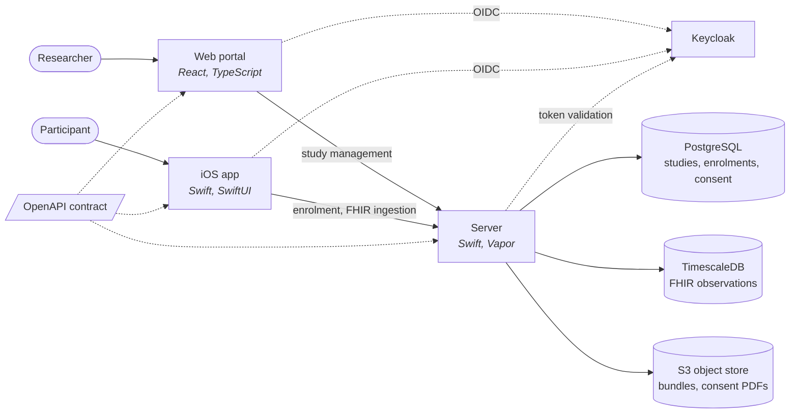

<!--
This source file is part of the Trove open-source project

SPDX-FileCopyrightText: 2026 Schmiedmayer Lab and the project authors (see CONTRIBUTORS.md)

SPDX-License-Identifier: MIT
-->

# Trove

[](https://github.com/SchmiedmayerLab/Trove/actions/workflows/build-and-test.yml)
[](https://github.com/SchmiedmayerLab/Trove/actions/workflows/codeql.yml)
[](LICENSE.md)

**Trove is an open-source platform for running longitudinal digital health studies.**

Research teams usually build a mobile app, a server, and a study-management layer from scratch for every project, and compile the study protocol into the app binary — so every protocol change needs a new App Store release. Trove separates the two. Researchers compose a study in the web portal, publish it as an immutable revision, and participants enrol against that revision. Changing a study does not mean shipping an app.

Data is FHIR from the moment it is collected, so what comes out is interoperable with clinical and research systems without a translation step.

## How it fits together



One OpenAPI contract in [`TroveAPI/`](TroveAPI) is the source of truth: the server conforms to the generated `APIProtocol`, iOS consumes the generated Swift client, and the web portal generates its TypeScript client from the same spec. A change to the contract that breaks a consumer breaks the build.

| Path | What it is | Stack |
|------|-----------|-------|
| [`TroveAPI/`](TroveAPI) | The shared OpenAPI contract and the Swift libraries generated from it | Swift, swift-openapi-generator |
| [`TroveServer/`](TroveServer) | Study lifecycle, enrolment, consent, and FHIR ingestion | Swift, Vapor, Fluent |
| [`TroveWeb/`](TroveWeb) | The researcher portal for composing and publishing studies | React, TypeScript, Vite |
| [`TroveiOS/`](TroveiOS) | The participant app: identity, study discovery, enrolment | Swift, SwiftUI |
| [`TroveInfrastructure/`](TroveInfrastructure) | GitOps deployment onto Kubernetes | Kustomize, ArgoCD, OpenTofu |

## Studies and revisions

A study is a set of components a researcher configures and combines: informational content, questionnaires, and health-data collection, each with its own schedule and eligibility rules. Publishing freezes the current definition into a numbered revision. Enrolments point at a revision rather than at the mutable study, so the terms a participant accepted stay fixed even as the researcher keeps editing.

## Storing the data

The three stores match three different access patterns:

- **PostgreSQL** holds study definitions, enrolments, and consent records. Content whose shape belongs to the shared package — per-locale text, eligibility expressions, schedules — is stored as JSONB so the package can evolve without a schema migration.
- **TimescaleDB** holds the FHIR observations in a `fhir_resources` hypertable. A study with a few hundred participants sampling at sub-minute cadence produces millions of rows a month, which a plain table does not serve well for time-windowed aggregates. The hypertable partitions on time in seven-day chunks and compresses chunks older than seven days, segmented per participant and code. Frequently filtered fields are projected into typed columns alongside the full FHIR resource.
- **S3-compatible object storage** holds study bundles and signed consent PDFs.

Keycloak is the sole authority for identities, roles, and group membership; all three applications authenticate against it over OpenID Connect and the server validates tokens against its JWKS.

## Running it locally

Start the backing services, apply the migrations, then run whichever component you are working on:

```bash
cd TroveInfrastructure/docker && cp .env.example .env && docker compose up -d
swift run --package-path TroveServer TroveServer migrate --yes
```

[`TroveInfrastructure/docker/smoke-test.sh`](TroveInfrastructure/docker/smoke-test.sh) checks the stack end to end — services healthy, realm imported, protected routes rejecting anonymous callers, and the server answering an authenticated request with the groups it synced from Keycloak. It runs in CI on every change to the server, web, or infrastructure.

## Continuous integration

`build-and-test.yml` is the entry point: it works out which components a change touches and runs only those, so a web-only change does not rebuild the iOS app.

| Job | Runs when |
|----------|-------------|
| API | `TroveAPI/**` |
| Server | `TroveServer/**`, `TroveAPI/**` |
| Web | `TroveWeb/**`, `TroveAPI/openapi.yaml` |
| iOS | `TroveiOS/**`, `TroveAPI/**` |
| Infrastructure | `TroveInfrastructure/**` |
| Dev Stack | `TroveServer/**`, `TroveWeb/**`, `TroveInfrastructure/**` |

`static-analysis.yml` runs SwiftLint across all three Swift components and scans the Swift code with CodeQL, which needs a build and so cannot run from `codeql.yml`; that one covers JavaScript and TypeScript. `repository-standards.yml` runs the organization checks. Test coverage from the Swift components is uploaded to Codecov. The checks that guard `main` live in [`.github/rulesets/main.json`](.github/rulesets/main.json).

Container images are published to `ghcr.io/schmiedmayerlab/trove-server` and `ghcr.io/schmiedmayerlab/trove-web`, built from the repository root so the inlined `TroveAPI/` package is in the build context.

## Platform Design and Roadmap

The [design documentation](docs/README.md) describes the target architecture, study model, integrations and delivery sequence. These plans are distinct from currently released functionality. Implementation priorities and status are tracked in the [Trove project](https://github.com/orgs/SchmiedmayerLab/projects/4).

## Contributing

Contributions to this project are welcome. Please make sure to read the [contribution guidelines](https://github.com/SchmiedmayerLab/.github/blob/main/CONTRIBUTING.md) and the [contributor covenant code of conduct](https://github.com/SchmiedmayerLab/.github/blob/main/CODE_OF_CONDUCT.md) first. You can find a list of contributors in the [CONTRIBUTORS.md](CONTRIBUTORS.md) file.

## License

This project is licensed under the MIT License. See [LICENSE.md](LICENSE.md) for details, and [CONTRIBUTORS.md](CONTRIBUTORS.md) for the list of contributors.

## Citation

If you use this software, please cite it using the metadata in [CITATION.cff](CITATION.cff), which GitHub surfaces through the [*Cite this repository*](https://docs.github.com/en/repositories/managing-your-repositorys-settings-and-features/customizing-your-repository/about-citation-files) button.

## Our Research

For more information, visit the [Schmiedmayer Lab GitHub organization](https://github.com/SchmiedmayerLab).


