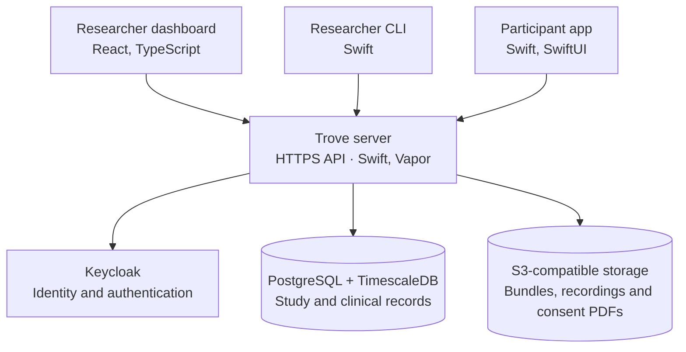

<!--
This source file is part of the Trove open-source project

SPDX-FileCopyrightText: 2026 Schmiedmayer Lab and the project authors (see CONTRIBUTORS.md)

SPDX-License-Identifier: MIT
-->

# Trove

**Study management for digital health research. Open source, built with Swift and Grove.**

Define a study in the web dashboard, then make it available to participants in the
iOS app. Trove brings study information, eligibility, enrollment, consent and
health-data collection into one platform.

[Take a Tour](docs/Platform-Tour.md) · [Run Locally](#running-it-locally) · [Read the Documentation](https://troveplatform.org)

## Why Trove

A digital health study needs more than an app: participants must find it, check
their eligibility, enroll and consent before any data is collected, and researchers
need that data in a form they can trust and retrieve. Trove covers that whole path
on one open-source platform.

- **One study definition.** Information, eligibility, enrollment, consent,
  questionnaires and health-data collection are configured together and published
  as a reviewed revision.
- **Terms that stay fixed.** Enrollments point at the revision a participant
  accepted, so later edits never change what they agreed to.
- **Health data from the sources participants already use.** The iOS app collects
  HealthKit data and, where a deployment enables it, SensorKit data, and keeps
  collecting offline. Deployments with approved provider registrations also collect
  from participants' linked wearable accounts.
- **Standard exchange.** Health data follows the
  [Grove FHIR implementation guides](https://schmiedmayerlab.github.io/grove-fhir/),
  so records use a documented FHIR structure rather than an app-specific format. The
  [event-admission contract](TroveServer/README.md#event-admission) lists the
  supported data and validation requirements.
- **Access you can account for.** A measurement is stored once and authorized
  separately for each study. Every data retrieval checks current authority and is
  audited first.
- **Open and extensible.** The server, CLI and iOS app are written in Swift and
  share one typed OpenAPI contract with the web dashboard. Study-specific apps can
  integrate through the same API. Trove is MIT licensed.

## For Research Teams

Set up eligibility and enrollment, edit consent documents, and add study components.
Preview what participants will see before publishing. Each published revision keeps
the study definition and consent terms together, separate from later draft edits.
Choose the health measurements and history a study collects, then retrieve its
authorized data and recordings from the results page or the [CLI](TroveAPI/CLI.md).

## For Participants

Discover a study, review its requirements, and enroll. Review and sign its consent
document before authorizing health-data collection. Collection continues offline
under the accepted study settings, and withdrawal stops it on the device at once.

<table>
  <tr>
    <th>Find a Study</th>
    <th>Review the Details</th>
    <th>Provide Consent</th>
  </tr>
  <tr>
    <td align="center"></td>
    <td align="center"></td>
    <td align="center"></td>
  </tr>
</table>

Trove is in beta and is being actively tested and used at Stanford.
These screenshots use a fictional Daily Activity
Study and synthetic participant data. The [tour](docs/Platform-Tour.md) shows the
current flows.

## How it fits together

[`TroveAPI/openapi.yaml`](TroveAPI/openapi.yaml) defines the HTTP contract.
The server conforms to its generated `APIProtocol`; the iOS app and CLI use the
generated Swift client, and the dashboard uses the generated TypeScript client.
The [CLI](TroveAPI/CLI.md) currently accepts an already-issued token rather than
providing its own login flow.

See [Data and Platform Architecture](docs/Data-and-Platform-Architecture.md)
for storage, authorization and synchronization details.

| Path | What it is | Stack |
|------|-----------|-------|
| [`TroveAPI/`](TroveAPI) | The shared OpenAPI contract and the Swift libraries generated from it | Swift, swift-openapi-generator |
| [`TroveServer/`](TroveServer) | Study lifecycle, enrolment, consent, and clinical data authority | Swift, Vapor, Fluent |
| [`TroveWeb/`](TroveWeb) | The researcher portal for composing and publishing studies and retrieving study data | React, TypeScript, Vite |
| [`TroveiOS/`](TroveiOS) | The participant app: identity, study discovery, enrolment, consent and health-data collection | Swift, SwiftUI |
| [`TroveInfrastructure/`](TroveInfrastructure) | GitOps deployment onto Kubernetes | Kustomize, ArgoCD, OpenTofu |

## Studies and revisions

A study is a set of components a researcher configures and combines: informational content, questionnaires, and health-data collection, each with its own schedule and eligibility rules. Publishing freezes the current definition into a numbered revision. Enrolments point at a revision rather than at the mutable study, so the terms a participant accepted stay fixed even as the researcher keeps editing.

## Storing the data

One **PostgreSQL database with TimescaleDB** holds study definitions, enrolments, consent,
audit records and clinical data. **S3-compatible object storage** holds immutable study
bundles, collected recordings and signed consent PDFs. A measurement relevant to several
studies is stored once, and withdrawal from one study does not change another study's data.

Keycloak is the sole authority for identities, roles, and group membership; all three applications authenticate against it over OpenID Connect and the server validates tokens against its JWKS.

## Running it locally

Follow the [local stack instructions](TroveInfrastructure/docker/README.md) to build the
current images and start the server, dashboard, Keycloak, database and object storage
with Docker Compose on a fresh development database.

[`TroveInfrastructure/docker/smoke-test.sh`](TroveInfrastructure/docker/smoke-test.sh) checks the stack end to end — services healthy, realm imported, protected routes rejecting anonymous callers, and the server answering an authenticated request with the groups it synced from Keycloak.

## Documentation

The [Trove documentation](https://troveplatform.org) walks through the platform and
explains its design: the study model, data architecture and integration contracts.
Its contributor guides cover engineering and verification, collection acceptance
and the documentation site itself.

## Contributing

See [repository working instructions](AGENTS.md) for implementation boundaries,
affected-component verification and safe test-resource handling.

Contributions to this project are welcome. Please make sure to read the [contribution guidelines](https://github.com/SchmiedmayerLab/.github/blob/main/CONTRIBUTING.md) and the [contributor covenant code of conduct](https://github.com/SchmiedmayerLab/.github/blob/main/CODE_OF_CONDUCT.md) first. You can find a list of contributors in the [CONTRIBUTORS.md](CONTRIBUTORS.md) file.

## License

This project is licensed under the MIT License. See [LICENSE.md](LICENSE.md) for details, and [CONTRIBUTORS.md](CONTRIBUTORS.md) for the list of contributors.

## Citation

If you use this software, please cite it using the metadata in [CITATION.cff](CITATION.cff), which GitHub surfaces through the [*Cite this repository*](https://docs.github.com/en/repositories/managing-your-repositorys-settings-and-features/customizing-your-repository/about-citation-files) button.

## Our Research

For more information, visit the [Schmiedmayer Lab GitHub organization](https://github.com/SchmiedmayerLab).

