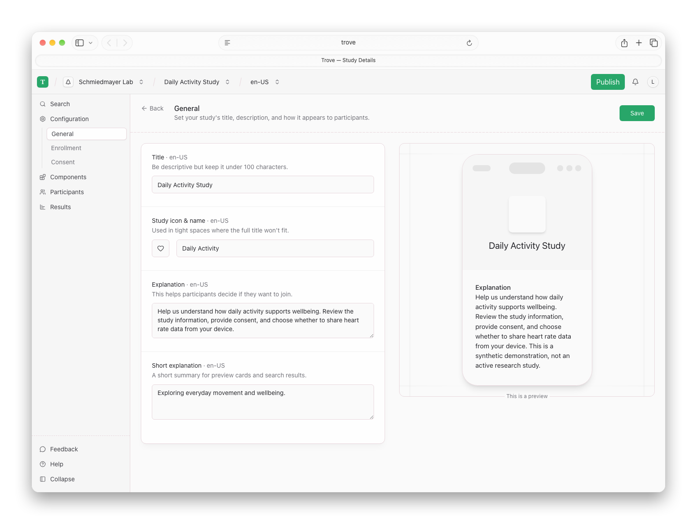
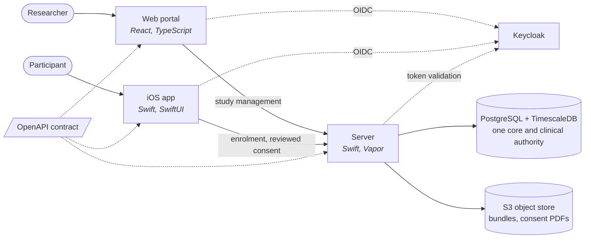

<!--
This source file is part of the Trove open-source project

SPDX-FileCopyrightText: 2026 Schmiedmayer Lab and the project authors (see CONTRIBUTORS.md)

SPDX-License-Identifier: MIT
-->

# Trove

**Trove is an open-source platform for running longitudinal digital health studies.**

Research teams usually build a mobile app, a server, and a study-management layer from scratch for every project, and compile the study protocol into the app binary — so every protocol change needs a new App Store release. Trove separates the two. Researchers compose a study in the web portal, publish it as an immutable revision, and participants enrol against that revision. Changing a study does not mean shipping an app.

Clinical exchange uses immutable events aligned with the Grove FHIR implementation
guide, exact resource identities and consent-backed study attribution. The former
unversioned observation upload endpoint is retired. See the server's
[event-admission contract](TroveServer/README.md#event-admission) for the supported
capabilities and required validator setup.

## Platform Tour

<picture><source media="(prefers-color-scheme: dark)" srcset="docs/images/web/study-details~dark.png"></picture>

The [platform tour](docs/Platform-Tour.md) shows current authoring and participant
flows with synthetic data, alongside the capabilities still on the roadmap.

## How it fits together

One OpenAPI contract in [`TroveAPI/`](TroveAPI) is the source of truth: the server conforms to the generated `APIProtocol`, iOS consumes the generated Swift client, and the web portal generates its TypeScript client from the same spec. A change to the contract that breaks a consumer breaks the build.

| Path | What it is | Stack |
|------|-----------|-------|
| [`TroveAPI/`](TroveAPI) | The shared OpenAPI contract and the Swift libraries generated from it | Swift, swift-openapi-generator |
| [`TroveServer/`](TroveServer) | Study lifecycle, enrolment, consent, and clinical data authority | Swift, Vapor, Fluent |
| [`TroveWeb/`](TroveWeb) | The researcher portal for composing and publishing studies | React, TypeScript, Vite |
| [`TroveiOS/`](TroveiOS) | The participant app: identity, study discovery, enrolment | Swift, SwiftUI |
| [`TroveInfrastructure/`](TroveInfrastructure) | GitOps deployment onto Kubernetes | Kustomize, ArgoCD, OpenTofu |

## Studies and revisions

A study is a set of components a researcher configures and combines: informational content, questionnaires, and health-data collection, each with its own schedule and eligibility rules. Publishing freezes the current definition into a numbered revision. Enrolments point at a revision rather than at the mutable study, so the terms a participant accepted stay fixed even as the researcher keeps editing.

## Storing the data

One **PostgreSQL database with TimescaleDB** owns study definitions, enrolments, consent,
audit and the clinical data boundary. Repositories participating in one accepted operation
share its explicit transaction; two separate database pools cannot provide that guarantee.
**S3-compatible object storage** holds immutable study bundles and signed consent PDFs.

Trove is in early development: schema changes target a fresh database, with no upgrade
or legacy-data import path. Recreate disposable development databases when their schema
changes; do not attach an old PostgreSQL data directory to a different engine image.
The IG receiver retains event custody separately from independently authorized
study grants; withdrawal from one study does not rewrite another study's evidence.

Keycloak is the sole authority for identities, roles, and group membership; all three applications authenticate against it over OpenID Connect and the server validates tokens against its JWKS.

## Running it locally

Follow the [local stack instructions](TroveInfrastructure/docker/README.md) to build the
current images and initialize a fresh database. The setup orders schema creation and explicit
runtime grants before server startup. Serving and schema-owner credentials are separate;
the runtime must not be a database owner.

[`TroveInfrastructure/docker/smoke-test.sh`](TroveInfrastructure/docker/smoke-test.sh) checks the stack end to end — services healthy, realm imported, protected routes rejecting anonymous callers, and the server answering an authenticated request with the groups it synced from Keycloak. It runs in CI on every change to the server, web, or infrastructure.

## Continuous integration

`build-and-test.yml` is the entry point: it works out which components a change touches and runs only those, so a web-only change does not rebuild the iOS app.

Manual runs and the weekly Sunday 06:17 UTC run select every Trove component,
including the native AMD64/ARM64 stack checks, to detect gaps in path selection.
They do not publish images or deploy services. This is the Trove matrix, not the
full matrix of its upstream Grove repository.

| Job | Runs when |
|----------|-------------|
| API | `TroveAPI/**` |
| Server | `TroveServer/**`, `TroveAPI/**` |
| Web | `TroveWeb/**`, `TroveAPI/openapi.yaml` |
| iOS | `TroveiOS/**`, `TroveAPI/**` |
| Infrastructure | `TroveInfrastructure/**` |
| Dev Stack | `TroveServer/**`, `TroveWeb/**`, `TroveInfrastructure/**` |
| Secret Scan | Every run, including documentation-only changes |
| Dependency Vulnerability Scan | Every run; also scheduled weekly |

`Required Verification` rejects failed, cancelled, missing or unexpectedly skipped
required jobs. The secret scan uses the same pinned tool and shared command locally
and in CI, tests synthetic negative controls, and retains location-only findings.
See [verification commands](AGENTS.md#verification).

The dependency scan requires every declared input to be analyzed and checks a
known-vulnerable control. Web and development-stack jobs also scan their built
application images by local image ID. Findings of any severity fail verification;
reports, input identities and CycloneDX inventories are retained as artifacts.

`static-analysis.yml` runs SwiftLint and, when repository access permits, Swift
CodeQL analysis. `codeql.yml` covers JavaScript and TypeScript under the same access
condition. A skipped CodeQL job is not security-analysis evidence.
`repository-standards.yml` runs the organization checks; coverage is uploaded to
Codecov. The proposed required checks are in
[`.github/rulesets/main.json`](.github/rulesets/main.json). This file does not apply
branch protection: an administrator must configure and verify hosted enforcement.

### Verified Image Candidates

The Dev Stack workflow builds the server and dashboard once on native AMD64 and
ARM64 runners. Each image must pass its vulnerability scan and stack checks;
the dashboard is tested both through instrumented Vite and as the built image.
Docker archives retain the tested image identities, build provenance and SBOMs.
Artifacts bind their bytes and scan evidence to one clean source tree and workflow
attempt. Local dirty-tree packages are useful for testing but cannot be published.

After required verification succeeds on `main`, `publish-images.yml` consumes
these archives without rebuilding. It requires the `candidate-publication`
environment to have required reviewers, prevent self-review and allow only
protected branches. An administrator must configure this environment and branch
protection before publication; missing configuration fails closed. Disable
administrator bypass as part of that setup. The API check verifies configuration,
not the absence of a privileged administrator override.

Candidates go to `ghcr.io/schmiedmayerlab/trove-server` and
`ghcr.io/schmiedmayerlab/trove-web` under source/run/attempt-specific tags. Publication
checks each registry digest and verifies that the combined index preserves both
platforms and their attestations. `Trove-Published-Candidate/candidate.json` records
the resulting digests. Consume those digests, not mutable tags. An expired advisory
database requires a new verification run before publication.

This publishes a candidate, not a deployment: it does not update `main` image tags,
deployment manifests or running services. Target configuration, recovery evidence,
identity/withdrawal reconciliation and deployment approval remain separate release
gates. A failed publication can leave partial candidate uploads, but produces no
successful candidate record and does not deploy them.

## Platform Design and Roadmap

The [design documentation](docs/README.md) describes the target architecture, study model, integrations and delivery sequence. These plans are distinct from currently released functionality. Implementation priorities and status are tracked in the [Trove project](https://github.com/orgs/SchmiedmayerLab/projects/4).

## Contributing

See [repository working instructions](AGENTS.md) for implementation boundaries,
affected-component verification and safe test-resource handling.

Contributions to this project are welcome. Please make sure to read the [contribution guidelines](https://github.com/SchmiedmayerLab/.github/blob/main/CONTRIBUTING.md) and the [contributor covenant code of conduct](https://github.com/SchmiedmayerLab/.github/blob/main/CODE_OF_CONDUCT.md) first. You can find a list of contributors in the [CONTRIBUTORS.md](CONTRIBUTORS.md) file.

## License

This project is licensed under the MIT License. See [LICENSE.md](LICENSE.md) for details, and [CONTRIBUTORS.md](CONTRIBUTORS.md) for the list of contributors.

## Citation

If you use this software, please cite it using the metadata in [CITATION.cff](CITATION.cff), which GitHub surfaces through the [*Cite this repository*](https://docs.github.com/en/repositories/managing-your-repositorys-settings-and-features/customizing-your-repository/about-citation-files) button.

## Our Research

For more information, visit the [Schmiedmayer Lab GitHub organization](https://github.com/SchmiedmayerLab).

