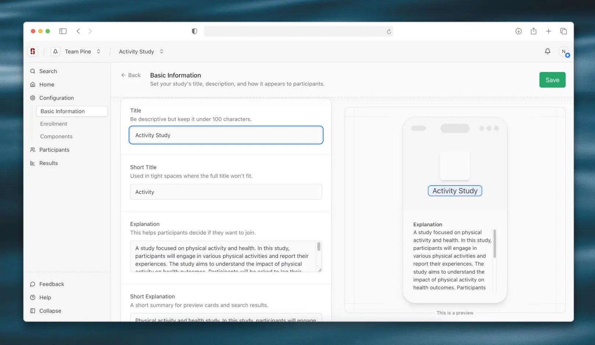

<!--
This source file is part of the Trove open-source project

SPDX-FileCopyrightText: 2026 Schmiedmayer Lab and the project authors (see CONTRIBUTORS.md)

SPDX-License-Identifier: MIT
-->

# Web

The researcher-facing portal. Researchers define studies by specifying metadata, participant criteria, and app components; those definitions then configure the participant app.



## Getting started

1. Install the dependencies: `npm install`
2. Copy the environment file: `cp .env.example .env`
3. Start the API server and Keycloak from [`TroveInfrastructure/docker`](../TroveInfrastructure/docker)
4. Start the development server: `npm run dev`

## API client

The TypeScript client is generated from the shared contract at [`TroveAPI/openapi.yaml`](../TroveAPI/openapi.yaml). Regenerate it after the contract changes:

```bash
npm run generate:api
```
