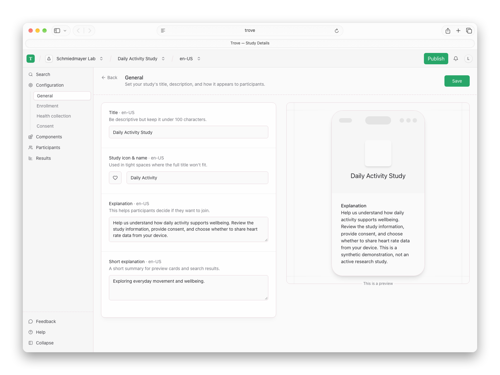

<!--
This source file is part of the Trove open-source project

SPDX-FileCopyrightText: 2026 Schmiedmayer Lab and the project authors (see CONTRIBUTORS.md)

SPDX-License-Identifier: MIT
-->

# Web

The researcher-facing portal. Researchers define studies by specifying metadata, participant criteria, and app components; those definitions then configure the participant app.

<picture><source media="(prefers-color-scheme: dark)" srcset="../docs/images/web/study-details~dark.png"></picture>

See the [platform tour](../docs/Platform-Tour.md) for current web and mobile
screens, and the [capture guide](../docs/images/README.md) to reproduce them.

## Getting started

1. Install the dependencies: `npm install`
2. Copy the environment file: `cp .env.example .env`
3. Start the API server and Keycloak from [`TroveInfrastructure/docker`](../TroveInfrastructure/docker)
4. Start the development server: `npm run dev`

Use Node.js 26, matching the container, workflows, and shared verification command.
TypeScript 7 supplies `tsc`; the `typescript` dependency aliases the official
TypeScript 6 compatibility package because OpenAPI generation and typed ESLint
still require its compiler API. See the [upstream migration guidance](https://devblogs.microsoft.com/typescript/announcing-typescript-7-0/).

Keep TanStack Table on version 8 until Grove's published `DataTable` accepts the
version 9 column definitions. The Grove design-system Zod override shares the
app's schema implementation with its form helpers; installing two incompatible
schema type graphs breaks form inference and can exhaust the lint heap. Check
generation, typed lint, build, and tests together when changing these dependencies.

The version-scoped `glob` and `minimatch` overrides select patched releases while
the lint and coverage tools still request vulnerable major versions. Keep
`eslint-plugin-import-x` at 4.18.1 or later for minimatch 11 compatibility. Remove
the overrides when the upstream dependency ranges select patched versions, and
rerun the shared web and dependency vulnerability checks.

## Health collection authoring

Study configuration → Health collection edits the draft's collection requirements
through the shared API with the revision that populated the form. Concurrent edits
are rejected without replacing unsaved values. Saving a draft does not change an
accepted participant scope; publish and obtain acceptance of the new version.

The editor configures independent heart-rate, body-weight, sleep-stage and workout windows from participant
acceptance, a Gregorian calendar lookback (six months initially), a fixed start, or
all available history. Sleep records and complete workouts are included whole when they overlap their
window; the form and scope summary disclose that they may extend outside it.
Choose an explicit IANA time zone for lookbacks and an optional exclusive end.
Fixed times use UTC strings, preserving the API's six fractional-second digits
through unrelated edits. Relative dates resolve once at acceptance on the server.
Unsupported settings remain unchanged and cannot be saved through this editor.

Native health-data components remain separate app configuration; adding a component
does not authorize server collection. The receiver admits heart-rate, body-weight, sleep-stage and complete workout
records. The native path implements these measurements; Apple-platform sleep and workout verification
remains outstanding. Route and metadata controls are not available in this editor.

The browser regressions in `e2e/collection-authoring.spec.ts` use the real authenticated
API to verify save/reload, exact date retention, invalid input, and stale revisions.
They exercise draft authoring, not publication or native data acquisition.

## Study results

Results loads one authorized page on request, with current measurement versions
selected by default. Researchers need membership in the study's group and its
explicit `data-reader` capability; administrator or audit access alone is
insufficient. The server independently authorizes and audits each disclosure.

Choose history to include superseded versions without treating them as additional
measurements. Next page follows the server's opaque cursor. Start from the first
page after eligibility changes or to include newly attributed historical records.
These pages are a live view, not a frozen final dataset or a clinical chart.

Each download decodes the returned derived FHIR Bundle directly to bytes, retaining
exact numeric values, source facts and study-specific derivation Provenance. Pages
are held only in the mounted view, outside the shared query cache. Changing study,
version mode or page size clears the results; starting another request clears the
previous page, and cancellation cannot restore it. Session termination unmounts
the view through the existing authentication boundary. Downloads already saved by
the researcher remain governed study data.

External original recordings have a separate **Save recording** action. It requests the
generated, authenticated study-recording endpoint for the selected grant and
version view; attachment URLs cannot redirect credentials to other endpoints.
The server verifies the original recording before disclosure. The browser checks
the binary transport, declared original media type and exact attachment byte count without parsing or
rewriting the payload. The closed recording-format/media registry permits CSV, typed native JSON, binary PPG, FHIR JSON (preserving declared release parameters), and CDA XML; unknown or mismatched representations fail. Files receive a safe media-derived suffix and are downloaded without inline previews. FHIR downloads retain the original numeric tokens even when
the page inspects attachment metadata.

Where the browser exposes the File System Access save picker, source bytes stream
to a temporary destination with backpressure; the destination is committed only
after the complete expected payload arrives. This requires a secure context and
a user-initiated save. Other browsers use an explicitly bounded 64 MiB payload
fallback. This is a browser implementation capacity limit, independent of study
collection and server download limits; fallback buffering and Blob creation can
use more memory than the payload itself. For larger recordings, use the
[Trove CLI](../TroveAPI/CLI.md) or a browser exposing the streaming save picker.
The page reports this limit before downloading and never offers a truncated file.

Changing the page, study, version mode or session cancels pending recording work;
the user can also cancel explicitly. A session change while the save picker is
open cannot transfer the request to the replacement account. Cancellation aborts
an unfinished destination, but cannot retract a file already committed or
handed to the browser's download manager. Unit tests cover stream backpressure,
size mismatches, cancellation, session replacement and fallback capacity; native
save-picker and operating-system disk behavior require browser verification.

The server exports heart-rate, body-weight, sleep and complete workout records. Pages count records
and do not split workout segments. Routes, full metadata adoption and final dataset
snapshots remain separate implementation work. A page
capacity refusal offers smaller page sizes; it never offers a partial download.

## Container transport

The image defaults to `APP_ENVIRONMENT=production` and serves HTTPS on port 8080.
Mount the PEM certificate chain and unencrypted private key read-only at
`/run/secrets/https/tls.crt` and `/run/secrets/https/tls.key`. Missing or invalid
identity files prevent startup; HTTP does not serve dashboard content. Restart
the container after certificate renewal and verify a fresh connection.

The local Compose files explicitly select `APP_ENVIRONMENT=development` for HTTP.
Other values are rejected. This does not change Vite's local development server.
Both modes use the same SPA, asset-cache and runtime-configuration rules.

The container uses one unprivileged Nginx worker and a read-only root filesystem
in Kubernetes and Compose. Its only writable volume is a 16 MiB in-memory cache
at `/var/cache/nginx`, holding the PID, runtime settings and temporary files.
The application assets and Nginx configuration remain read-only.

Frontend request logs are disabled because URLs may contain authentication codes
or participant identifiers. Startup diagnostics remain available; deployed ingress
logs retain only the configured allowlisted operational fields.

CI builds the image and runs `TroveInfrastructure/tools/verify_web_image.py` against
it. The same local check requires Docker, Node.js 26, and the pinned Python tooling
dependencies:

```bash
docker build -f TroveWeb/Dockerfile -t trove-web:local .
python3 -m venv .build/web-tooling
.build/web-tooling/bin/pip install -r TroveInfrastructure/tools/requirements.txt
.build/web-tooling/bin/python TroveInfrastructure/tools/verify_web_image.py --image trove-web:local
```

Run these commands from the repository root. The verifier owns and removes its
containers, network and synthetic certificates; its evidence directory contains
only logs and a result summary. This is not live-cluster or release acceptance.

## API client

The TypeScript client is generated from the shared contract at [`TroveAPI/openapi.yaml`](../TroveAPI/openapi.yaml). Regenerate it after the contract changes:

```bash
npm run generate:api
```

Handwritten client boundaries live outside the generated directory. HTTP failures
become `ApiError` values using the response status, not a status supplied in the
response body. Only string problem titles and details are accepted. Network and
cancellation errors retain their original identity because no HTTP response exists.

The access-token provider owns a request session. Replacing or removing the
provider cancels its requests; pending refreshes and late JSON results cannot be
adopted by the replacement session. Concurrent requests share a refresh within
that session, while cancelling one request does not cancel the others. API
requests are restricted to the configured origin and reject redirects. Register
or clear the provider at authentication boundaries rather than overriding the
client's fetch configuration; tests mock the underlying network transport.
Cancellation cannot undo a mutation already accepted by the server; it is not
permission to replay that mutation automatically after signing in again.

`AuthProvider` owns session closure and cache clearing. Logout, refresh failure,
malformed identity claims, or a changed issuer, subject, audience, realm role or
group closes the dashboard before continuing. Late Keycloak refresh callbacks
cannot reopen that lifetime. Continuing uses a fresh page so router state is
not reused across authority changes; ordinary token renewal keeps the current
session and updates display claims. Logout uses Keycloak's POST flow, while local
credentials and UI access are closed even if navigation fails. This does not
claim that the identity provider completed logout while it was unreachable.

Dashboard group roles require an exact `/group/admin` or `/group/researcher`
claim. Extra path segments do not grant a role, and an explicit administrator
role takes precedence regardless of claim order. These roles support the UI;
the server independently authorizes every protected operation. Audit access is
not inferred from a dashboard role.
