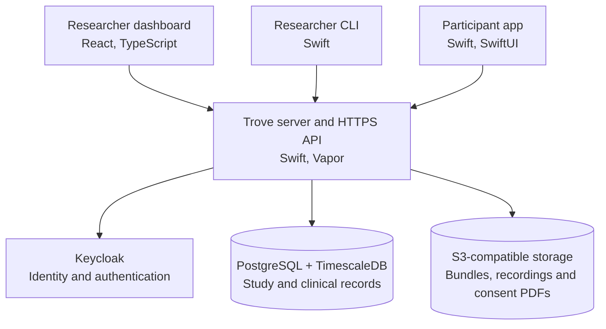

<!--
This source file is part of the Trove open-source project

SPDX-FileCopyrightText: 2026 Schmiedmayer Lab and the project authors (see CONTRIBUTORS.md)

SPDX-License-Identifier: MIT
-->

# Data and Platform Architecture

Trove's Swift server handles study operations and data access for the dashboard,
command-line client and participant app. PostgreSQL with TimescaleDB stores study
and clinical records; S3-compatible storage holds bundles, recordings and consent PDFs.
Keycloak handles authentication.

## Components

The diagram also appears in the [repository README](https://github.com/SchmiedmayerLab/Trove#architecture).
OpenAPI defines the shared server interface and generated client types.
All clients use the server's authorization checks; none receives direct database
or object-store credentials. The [CLI](https://github.com/SchmiedmayerLab/Trove/blob/main/TroveAPI/CLI.md)
accepts an already-issued token; it does not provide a login flow.

The implemented foundation covers study publication, enrollment and consent,
record-based health-data collection, source-event custody, independent study
grants, study-scoped data retrieval and scoped audit reads.

## Database and Object Storage

The Swift service owns identity relationships, study revisions, consent, data attribution and access decisions.

Core study and clinical tables share one PostgreSQL database. Records are stored
according to their transaction and query requirements:

| Storage role | Records |
|---|---|
| Relational control and identity tables | Studies, revisions, enrollments, consent, source identities and study grants |
| Time-partitioned clinical storage | High-volume measurements and their queryable projections |
| Object storage | Bundles, recordings and consent PDFs |

An operation passes the same transaction handle through repositories that update
core tables and Timescale projections. Separate databases or independently acquired
connections would not provide that atomicity. Keycloak maintains its own identity
store outside core transactions.

A clinical database per study would duplicate measurements and complicate
consent and source-history updates. Separate services are reserved for workloads
that need a distinct security or operational boundary.

## Authorization and Audit

Protected API operations validate the caller's signature, permitted algorithm, configured issuer, intended API audience and required lifetime/identity claims before constructing an authenticated context. Missing verification configuration or unavailable verification material cannot disable checks. A valid token establishes identity, not access to every study.

Domain authorization then checks current role, enrollment, consent, purpose and applicable study state. List filters, counts, fields, artifacts and background jobs enforce the same boundaries as individual records. Client and service credentials have explicit audiences and narrow operation scopes. Group administration does not automatically grant access to identifiable data. Notifications and opaque identifiers are not access grants.

Revocation takes effect at new admission and at defined commit or disclosure boundaries. Long-running jobs recheck permission before releasing results. Work already dispatched to an external provider may be irreversible; fencing prevents it from reopening revoked work, while reconciliation records its outcome.

An append-only activity record identifies the actor, delegated initiator, action, scope, target/version, outcome and correlation identifier. Protected mutations commit their activity/outbox records atomically. Sensitive reads and recording downloads require durable activity acceptance before disclosure; unavailable recording denies that disclosure. Denied requests remain denied even if diagnostic logging fails.

Activity history excludes bearer tokens, clinical bodies and contact addresses.
Runtime roles cannot rewrite it, and reading it requires a separate permission. Database administrators still control the underlying storage.

The study audit reader requires researcher identity and both `admin` and
`audit-reader` membership in the owning group. The reader capability is explicitly
assigned by the identity administrator; administration alone does not imply it.
`GET /studies/{studyId}/audit-events` returns at most 100 records matching the study
and group, never participant/source history inferred through an enrollment. Pages
use an in-scope event ID as a cursor, require committed disclosure intent and carry
`Cache-Control: no-store`. Audit identifiers remain governed data. This bounded
history reader is not a cross-study activity feed, frozen export or retention policy.

## Source Data and Study Attribution

Clinical retrieval uses a separately assigned `data-reader` group capability in
addition to researcher identity and membership. `GET /studies/{studyId}/data`
returns bounded, live pages of derived FHIR collection Bundles with exact numeric
tokens, stable study subjects, historical protocol context and derivation
Provenance. The receiver retains original custody bytes separately. Selection,
current-authority checks and disclosure audit share a transaction; a failed audit
cannot return clinical data. See [study data access](https://github.com/SchmiedmayerLab/Trove/blob/main/TroveServer/README.md#study-data-access)
for response limits, cursor semantics and the current point-data capability.

Consider a participant whose heart-rate observation is eligible for two studies. The source event and its resource version are stored once within the appropriate participant/source scope. Each eligible study receives a separate, exact attribution record.

Those attributions identify the authorized enrollment, study revision and resource version. They are not inferred from whoever uploaded the record, nor from an unfiltered list of study references supplied by a client.

Removing another study's associations from returned data creates a derived representation with explicit lineage. It must not masquerade as the original immutable producer event under the same event identity. Preserve the exact historical study/protocol references needed to interpret the authorized view.

If the participant withdraws from one study, the platform updates that study's permitted collection and access. It does not automatically delete a payload still retained for another independently authorized purpose.

The important distinction is between physical deduplication and permission:

- Reusing a stored payload does not grant another study access.
- Access to a derived summary does not automatically include its raw recording.
- Deduplication stays within a governed identity, controller and region. It is not a global search for matching people or measurements.

Capacity measurements include the attribution metadata as well as payloads.

### Source Identity

Two equal values at the same time are not necessarily the same measurement. A daily summary and a granular sample are not interchangeable. Copies arriving through a phone, a platform health store and a vendor API may lack sufficient evidence to establish that they are one source output.

Identity therefore comes from the admitted producer/source contract and its recorded scope. Values and timestamps support interpretation, not automatic cross-source deduplication. Where the source lacks stable identifiers, the acquisition route needs a durable import identity and explicit limitations.

## Events, Versions and References

A FHIR exchange can contain several related resources. Flattening it into only the primary Observation loses context needed to interpret devices, recordings, provenance and companion outputs.

Trove preserves source events, exact resource versions and graph references alongside useful projections. Lifecycle operations have distinct meanings:

- Replaying the same event returns its original receipt.
- Changing content under an existing immutable event identity is a conflict.
- A correction creates explicit version history using the admitted writer's ordering.
- A retraction can arrive before its target; a later upload must not resurrect it.
- A retraction comes only from a participant's HealthKit deletion report and applies to every study holding the record. It remains a tombstone; only an audited operator command can reverse it, without rewriting custody.
- Late study attribution changes permission metadata, not the original producer event.

Some references may arrive later than their dependent data. The receiver can keep an authorized but incomplete graph pending. Missing authorization is not a reason to accept data provisionally as though permission existed.

Transport batching and compression are separate concerns. Several complete events can share a transport envelope without becoming a single permission unit. Physical encoding changes must preserve the checksum and identity semantics of the original content.

## FHIR as the Exchange Contract

Trove uses [Grove FHIR profiles](https://schmiedmayerlab.github.io/grove-fhir/) to define interoperable data at its boundaries, while choosing efficient internal representations. Clinical resources keep their exact versions and relationships.

Not every internal record belongs in FHIR. Queue leases, pagination cursors, retry counters and credential references are operational state. Serializing them as clinical resources would add complexity without improving exchange.

Profile validation and graph-consistency checks establish different properties. A structurally valid resource can still refer to the wrong subject or an unavailable required result. Neither kind of validation establishes permission to disclose the data.

## Artifact Storage

Bundles, consent PDFs and collected recordings use object storage. A participant client declares a recording transfer, uploads the file and binds it to its clinical record only after the server verifies the content against the declaration and returns a receipt. Authorized study readers download recordings through the study data API under the same grant and audit checks as other study data.

Consent PDFs and recordings share this storage without sharing readers. Each feature module decides which permissions apply.

Files become reachable only after durable acceptance and verification. Opaque artifact identifiers are preferable to treating a caller-supplied URL as authority. A later storage move can change a physical locator without changing the identity of the accepted content.

## API Contracts

OpenAPI owns routes and schemas; Swift and TypeScript consumers are generated
from it. The dashboard and CLI use the same contract, with permissions enforced
by the server.

Analysis tools consume study-scoped data through this API. Direct database access
is not the platform's integration contract.

The following conventions guide new operations; the versioned OpenAPI definition
is the reference for available endpoints and their exact request requirements.

- Participant routes derive identity from verified authentication; a supplied participant, enrollment or source identifier never grants access. Researcher and service operations enforce their own study, field and purpose scopes.
- Mutable resources expose opaque state versions as ETags. Version-conditional commands use If-Match; immutable published revisions, artifact digests and FHIR canonical versions remain distinct identifiers.
- A study draft version covers interpretation-relevant components, schedules and artifact references. Editing any of them invalidates prior validation; publication rechecks the exact candidate and its complete reference closure.
- Delegated operations intersect current grantor authority, registered-client restrictions and a revocable study/operation grant. Derive actor/client/initiator at the trusted boundary; recheck queued execution and result disclosure. Capability discovery is bounded and advisory, never authorization.
- Commands with replay risk carry an Idempotency-Key scoped to the verified actor, operation and target. Matching content returns the original receipt only after current authorization to that receipt; altered content conflicts. Resolve an authorized completed replay before applying the new-command version check. An expired/unknown key must not bypass domain uniqueness.
- Validate exact artifacts and expensive external rules before database locks. In the transaction, recheck current authority, expected state and digest-bound evidence while committing the domain change and audit/outbox record.
- Lists have bounded limits and opaque snapshot/delta cursors. Cursor expiry requests a fresh snapshot; counts, filtering and pagination enforce the same scope as item reads.
- Error responses expose stable codes, safe field/rule diagnostics and a correlation ID. They never contain tokens, clinical payloads or another study's existence.

The HTTP contract conventions distinguish unauthenticated (401), denied operation (403), concealed/absent resource (404), conflicting state or changed replay (409), stale If-Match (412), invalid/unsupported input (422), quota/backpressure (429) and unavailable required services (503). Missing validators or authorization cannot produce a success response.

## State and Synchronization

Authoritative changes use domain commands with expected state versions and idempotency identifiers. Authorization, the accepted state transition and its traceability are committed consistently. Repeated requests cannot manufacture a second enrollment or consent.

Expensive validation and external work occur outside database locks. Validation evidence is bound to exact content and contract versions; the transaction rechecks that evidence, current eligibility and result availability before committing.

Provider calls are not part of a database transaction. A timeout may leave their outcome uncertain. Durable checkpoints and reconciliation handle that uncertainty rather than assuming a retry is harmless.

Clients use authorized snapshots and paginated changes with consistent boundaries. A watermark must represent committed changes; a sequence number allocated before commit is insufficient because concurrent transactions can commit in another order. Scope and reauthorize every page. Clients advance a checkpoint only after durably applying that page, and replay after interruption must be harmless. Expired cursors cause a new snapshot without discarding pending commands.

Notifications request synchronization; they are not authoritative state. Local queues distinguish pending, accepted and rejected work. Restoring a backup does not authorize replaying previously dispatched provider operations.

## Capacity Planning

Participant count alone is not a capacity estimate. Storage and throughput depend on measurement frequency, graph size, recording payloads, attribution, indexes, historical imports and retention.

Capacity testing starts with authenticated ingestion, simultaneous study attribution, corrections, retractions and recovery. Time to deny disallowed access and time to finish background cleanup are separate measures.

Bounded batches, streaming file handling, backpressure, fair job scheduling and separate budgets for backfill protect current collection.

Storage estimates include attribution records and indexes, not just payloads.
Database partitioning decisions also account for access checks and recovery.
