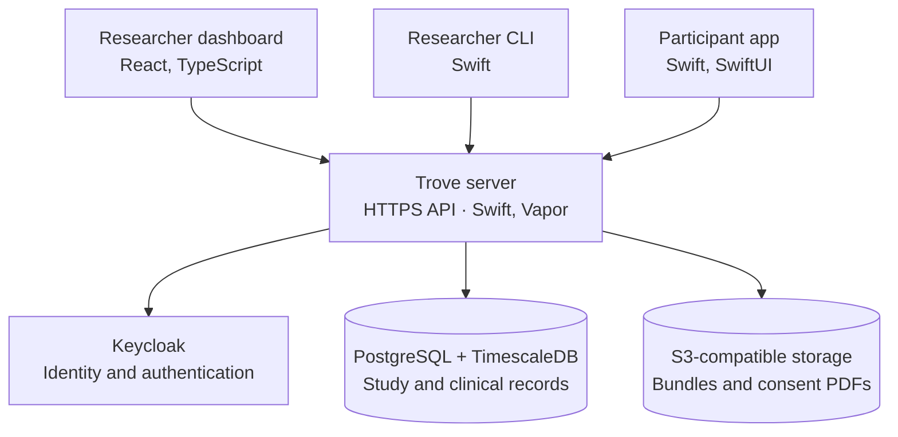

<!--
This source file is part of the Trove open-source project

SPDX-FileCopyrightText: 2026 Schmiedmayer Lab and the project authors (see CONTRIBUTORS.md)

SPDX-License-Identifier: MIT
-->

# Data and Platform Architecture

Trove's Swift server handles study operations and data access for the dashboard,
command-line client and participant app. PostgreSQL with TimescaleDB stores study
and clinical records; S3-compatible storage holds bundles and consent PDFs.
Keycloak handles authentication.

## Components

The diagram also appears in the [repository README](https://github.com/SchmiedmayerLab/Trove#how-it-fits-together).
OpenAPI defines the shared server interface and generated client types.
All clients use the server's authorization checks; none receives direct database
or object-store credentials. The [CLI](https://github.com/SchmiedmayerLab/Trove/blob/4273560d0c3e6454219995b649d56dce1e234135/TroveAPI/CLI.md)
accepts an already-issued token; it does not yet provide a login flow.

The implemented foundation covers study publication, enrollment and consent,
source-event custody, independent study grants and scoped audit reads. Task
synchronization, conversations, generalized artifacts, exports and erasure are
extensions to that foundation; their design is described below. [Milestones](https://github.com/SchmiedmayerLab/Trove/milestones) and
[issues](https://github.com/SchmiedmayerLab/Trove/issues) track implementation.

## Database and Object Storage

The Swift service owns identity relationships, study revisions, consent, data attribution and access decisions. Planned task and worker services use the same domain operations.

Core study and clinical tables share one PostgreSQL database. The design assigns
records to storage according to their transaction and query requirements:

| Storage role | Suitable records |
|---|---|
| Relational control and identity tables | Studies, enrollments, consent, source identities, exact version grants and task state |
| Time-partitioned clinical storage | High-volume measurements and their queryable projections |
| Indexed interaction records | Accepted questionnaire results, conversation messages and reproducible exchange metadata |
| Governed object storage | Recordings, instruments, consent files, imported documents, transcripts and exports |

An operation passes the same transaction handle through repositories that update
core tables and Timescale projections. Separate databases or independently acquired
connections would not provide that atomicity. Keycloak maintains its own identity
store; the planned extension-document service also remains outside core transactions.

A clinical database per study would duplicate measurements and complicate
consent and source-history updates. Separate services are reserved for workloads
that need a distinct security or operational boundary.

## Authorization and Audit

Protected API operations validate the caller's signature, permitted algorithm, configured issuer, intended API audience and required lifetime/identity claims before constructing an authenticated context. Missing verification configuration or unavailable verification material cannot disable checks. A valid token establishes identity, not access to every study.

Domain authorization then checks current role, enrollment, consent, purpose and applicable study state. List filters, counts, fields, artifacts and background jobs enforce the same boundaries as individual records. Client and service credentials have explicit audiences and narrow operation scopes. Group administration does not automatically grant identifiable data or unblinded results. Notifications and opaque identifiers are not access grants.

Revocation takes effect at new admission and at defined commit or disclosure boundaries. Long-running jobs recheck permission before releasing results. Work already dispatched to an external provider may be irreversible; fencing prevents it from reopening revoked work, while reconciliation records its outcome.

An append-only activity record identifies the actor, delegated initiator, action, scope, target/version, outcome and correlation identifier. Protected mutations commit their activity/outbox records atomically. Sensitive reads, exports and artifact downloads require durable activity acceptance before disclosure; unavailable recording denies that disclosure. Denied requests remain denied even if diagnostic logging fails.

Activity history excludes bearer tokens, clinical bodies, contact addresses and
transcripts. Runtime roles cannot rewrite it, and reading it requires a separate
permission. Database administrators still control the underlying storage.

The study audit reader requires researcher identity and both `admin` and
`audit-reader` membership in the owning group. The reader capability is explicitly
assigned by the identity administrator; administration alone does not imply it.
`GET /studies/{studyId}/audit-events` returns at most 100 records matching the study
and group, never participant/source history inferred through an enrollment. Pages
use an in-scope event ID as a cursor, require committed disclosure intent and carry
`Cache-Control: no-store`. Audit identifiers remain governed data. This bounded
history reader is not a cross-study activity feed, frozen export or retention policy.

## Source Data and Study Attribution

Consider a participant whose heart-rate observation is eligible for two studies. The source event and its resource version are stored once within the appropriate participant/source scope. Each eligible study receives a separate, exact attribution record.

Those attributions identify the authorized enrollment, study revision and resource version. They are not inferred from whoever uploaded the record, nor from an unfiltered list of study references supplied by a client.

Removing another study's associations for export creates a derived representation with explicit lineage. It must not masquerade as the original immutable producer event under the same event identity. Preserve the exact historical study/protocol references needed to interpret the authorized view.

If the participant withdraws from one study, the platform updates that study's permitted collection and access. It does not automatically delete a payload still retained for another independently authorized purpose. Once no permitted purpose remains, the applicable erasure or retention process takes effect.

The important distinction is between physical deduplication and permission:

- Reusing a stored payload does not grant another study access.
- Access to a derived summary does not automatically include its raw recording.
- Conversation answers and questionnaire responses are generally task-specific; identical content does not make them one shared research result.
- Deduplication stays within a governed identity, controller and region. It is not a global search for matching people or measurements.

Capacity measurements include the attribution metadata as well as payloads.

### Source Identity

Two equal values at the same time are not necessarily the same measurement. A daily summary and a granular sample are not interchangeable. Copies arriving through a phone, a platform health store and a vendor API may lack sufficient evidence to establish that they are one source output.

Identity therefore comes from the admitted producer/source contract and its recorded scope. Values and timestamps support interpretation, not automatic cross-source deduplication. Where the source lacks stable identifiers, the acquisition route needs a durable import identity and explicit limitations.

## Events, Versions and References

A FHIR exchange can contain several related resources. Flattening it into only the primary Observation loses context needed to interpret devices, recordings, provenance and companion outputs.

Trove preserves source events, exact resource versions and graph references alongside useful projections. Lifecycle operations have distinct meanings:

- Replaying the same event returns its original receipt.
- Changing content under an existing immutable event identity is a conflict.
- A correction creates explicit version history using the admitted writer's ordering.
- A retraction can arrive before its target; a later upload must not resurrect it.
- Late study attribution changes permission metadata, not the original producer event.

Some references may arrive later than their dependent data. The receiver can keep an authorized but incomplete graph pending. Missing authorization is not a reason to accept data provisionally as though permission existed.

Transport batching and compression are separate concerns. Several complete events can share a transport envelope without becoming a single permission unit. Physical encoding changes must preserve the checksum and identity semantics of the original content.

## FHIR as the Exchange Contract

Trove uses [Grove FHIR profiles](https://schmiedmayerlab.github.io/grove-fhir/) to define interoperable data at its boundaries, while choosing efficient internal representations. Clinical resources, study definitions and interaction records should be exportable with their exact versions and relationships.

Not every internal record belongs in FHIR. Queue leases, pagination cursors, retry counters, credential references and usage reservations are operational state. Serializing them as clinical resources would add complexity without improving exchange.

The planned study-interaction mapping builds on existing R4 resource types:

| Meaning | Exchange representation |
|---|---|
| Published protocol and component definitions | Versioned PlanDefinition and ActivityDefinition |
| Assigned occurrence and accepted completion | Task with stable identity and result references |
| Questionnaire instrument and result | Questionnaire and exact-version QuestionnaireResponse |
| Accepted conversation message | Communication linked to its occurrence and, where relevant, another message |
| Immutable transcript or recording artifact | DocumentReference with exact content identity |
| Generated or derived output lineage | Provenance identifying available software/configuration and authorized input versions |

Task's canonical instantiation reference targets ActivityDefinition. Typed inputs identify enrollment, component revision, instrument and permitted performance window; executionPeriod records actual work. QuestionnaireResponse results are referenced from Task output; QuestionnaireResponse.partOf is not used as a Task link. Communication links to an occurrence through partOf and to a prior message through inResponseTo. These mappings follow the [FHIR R4 Task](https://hl7.org/fhir/R4/task-definitions.html), [QuestionnaireResponse](https://hl7.org/fhir/R4/questionnaireresponse.html) and [Communication](https://hl7.org/fhir/R4/communication.html) definitions.

The text-transcript profile uses a bounded collection Bundle of exact accepted Communication versions with sealed entry order. DocumentReference identifies that immutable attachment; correction creates a replacement, not rewritten historical bytes. Its standard R4 attachment hash and stronger application artifact digest retain their separate meanings.

Profile validation and graph-consistency checks establish different properties. A structurally valid resource can still refer to the wrong subject or an unavailable required result. Neither kind of validation establishes permission to disclose the data.

Study-interaction profiles are separate from the mobile measurement exchange. Scheduling transport and conversation streaming do not require expanding the measurement resource whitelist or inventing a new recording format.

## Artifact Storage

Bundles and consent PDFs already use object storage. The planned common artifact interface extends staging, ownership, size limits, checksum verification and authorized retrieval to instruments, recordings and other immutable files.

The same mechanics can serve a consent document, a raw recording and a retrieval corpus without giving them the same readers or retention rules. Feature modules decide which purpose and permissions apply.

Files become reachable only after durable acceptance and verification. Opaque artifact identifiers are preferable to treating a caller-supplied URL as authority. A later storage move can change a physical locator without changing the identity of the accepted content.

## API Contracts

OpenAPI owns routes and schemas; Swift and TypeScript consumers are generated
from it. The dashboard and CLI use the same contract. Planned hosted tools and
delegated clients will use it as well, with permissions enforced by the server.

Questionnaire APIs follow the [localization contract](Study-Model-and-Research-Workflows.md#localization-sites-and-accessibility):
one multilingual artifact, revision-checked updates and language-specific diagnostics.
Validation binds the complete artifact digest, pinned IG and renderer capabilities.
Approval additionally binds language and applicability.

The following conventions guide new operations; the versioned OpenAPI definition
is the reference for available endpoints and their exact request requirements.

- Participant routes derive identity from verified authentication; a supplied participant, enrollment or source identifier never grants access. Researcher and service operations enforce their own study, field and purpose scopes.
- Mutable resources expose opaque state versions as ETags. Version-conditional commands use If-Match; immutable published revisions, artifact digests and FHIR canonical versions remain distinct identifiers.
- A study draft version covers interpretation-relevant components, schedules and artifact references. Editing any of them invalidates prior validation; publication rechecks the exact candidate and its complete reference closure.
- Delegated operations intersect current grantor authority, registered-client restrictions and a revocable study/operation grant. Derive actor/client/initiator at the trusted boundary; recheck queued execution and result disclosure. Capability discovery is bounded and advisory, never authorization.
- Commands with replay risk carry an Idempotency-Key scoped to the verified actor, operation and target. Matching content returns the original receipt only after current authorization to that receipt; altered content conflicts. Resolve an authorized completed replay before applying the new-command version check. An expired/unknown key must not bypass domain uniqueness.
- Validate exact artifacts and expensive external rules before database locks. In the transaction, recheck current authority, expected state and digest-bound evidence while committing the domain change and audit/outbox record.
- Lists have bounded limits and opaque snapshot/delta cursors. Cursor expiry requests a fresh snapshot; counts, filtering and pagination enforce the same scope as item reads.
- Long-running work returns a durable job ID, state and scoped progress. Cancellation is best-effort once an external effect has been dispatched; uncertain results require reconciliation. Job IDs and notifications grant no access.
- Error responses expose stable codes, safe field/rule diagnostics and a correlation ID. They never contain tokens, clinical payloads or another study's existence.

The HTTP contract conventions distinguish unauthenticated (401), denied operation (403), concealed/absent resource (404), conflicting state or changed replay (409), stale If-Match (412), invalid/unsupported input (422), quota/backpressure (429) and unavailable required services (503). A successful transport or 202 job admission is not accepted task completion. Missing validators or authorization cannot produce a success response.

## State and Synchronization

The synchronization design extends existing transactional commands and retry
receipts to server-assigned tasks and external jobs.

Authoritative changes use domain commands with expected state versions and idempotency identifiers. Authorization, the accepted state transition and its traceability are committed consistently. Repeated requests cannot manufacture a second enrollment, task completion or allocation.

Expensive validation and external work occur outside database locks. Validation evidence is bound to exact content and contract versions; the transaction rechecks that evidence, current eligibility and result availability before committing.

Provider calls are not part of a database transaction. A timeout may leave their outcome uncertain. Durable jobs, reservations and reconciliation handle that uncertainty rather than assuming a retry is harmless.

Clients use authorized snapshots and paginated changes with consistent boundaries. A watermark must represent committed changes; a sequence number allocated before commit is insufficient because concurrent transactions can commit in another order. Scope and reauthorize every page. Clients advance a checkpoint only after durably applying that page, and replay after interruption must be harmless. Expired cursors cause a new snapshot without discarding pending commands.

Notifications request synchronization; they are not authoritative state. Local queues distinguish pending, accepted and rejected work. Restoring a backup does not authorize replaying previously dispatched messages, inference calls or provider operations: keep outgoing work paused until its external effects and current permissions are reconciled.

## Retention, Erasure and Result Availability

Coordinated erasure and closeout are planned lifecycle capabilities.

Consent history, source retraction and privacy-related erasure serve different purposes. The platform preserves those distinctions while applying the required lifecycle to payloads, projections, artifacts, caches and exports.

A completed task records that an accepted action occurred. It does not guarantee that its evidence may remain accessible forever. For results held in a separate extension service, immutable acceptance receipts identify the exact result and its owner.

Erasure marks a shared result unavailable in the core authority before asynchronous payload removal. That ordering prevents a completion from accepting already-unavailable evidence. If completion was accepted first, its permitted historical assertion remains distinct from whether the result can still be read or exported.

Restoration must reapply relevant erasures and access invalidations before serving recovered data. A backup is not an independent permission to make deleted information available again.

## Operational Views and Research Exports

Operational query design is limited to running a study: task state, collection counts, freshness, coverage, setup problems and export progress. Counts and status views still need subject, study and field-level authorization.

Coverage is reported only where the admitted source provides a meaningful denominator. Recent synchronization can still be partial. Missing records do not prove non-adherence, and absent source-quality evidence remains unknown.

The planned export format preserves exact membership, resource and instrument versions, attribution, provenance and artifact checksums. A codebook explains the exported fields and relevant source limitations. Preparing an export and releasing it are separate stages; access is checked again at release.

Scientific analysis belongs in separately governed tools or environments consuming authorized exports. Direct database access is not the platform's integration contract.

## Capacity Planning

Participant count alone is not a capacity estimate. Storage and throughput depend on measurement frequency, graph size, recording payloads, attribution, indexes, historical imports and retention.

Capacity testing starts with authenticated ingestion, simultaneous study attribution, corrections, retractions and recovery. Export, closeout and erasure workloads require additional benchmarks as those capabilities are introduced. Time to deny disallowed access and time to finish background cleanup are separate measures.

Bounded batches, streaming file handling, backpressure, fair job scheduling and separate budgets for backfill protect current collection. Identity registries retain partition or archive locations as payloads move out of hot storage.

Storage estimates include attribution records and indexes, not just payloads.
Database partitioning decisions also account for access checks and recovery.
