<!--
SPDX-FileCopyrightText: 2026 Schmiedmayer Lab and the project authors (see CONTRIBUTORS.md)
SPDX-License-Identifier: MIT
-->

# Platform Tour

Trove connects researcher-authored study definitions with participant identity,
enrollment, reviewed consent and health-data collection. These screenshots show
the beta application with a fictional **Daily Activity Study** and synthetic accounts.
[Capture details and reproduction](images/README.md).

## Study Authoring

Researchers configure a study in order: general information, enrollment and
participation criteria, then consent. Study components have their own top-level menu.

<picture><source media="(prefers-color-scheme: dark)" srcset="images/web/study-details~dark.png">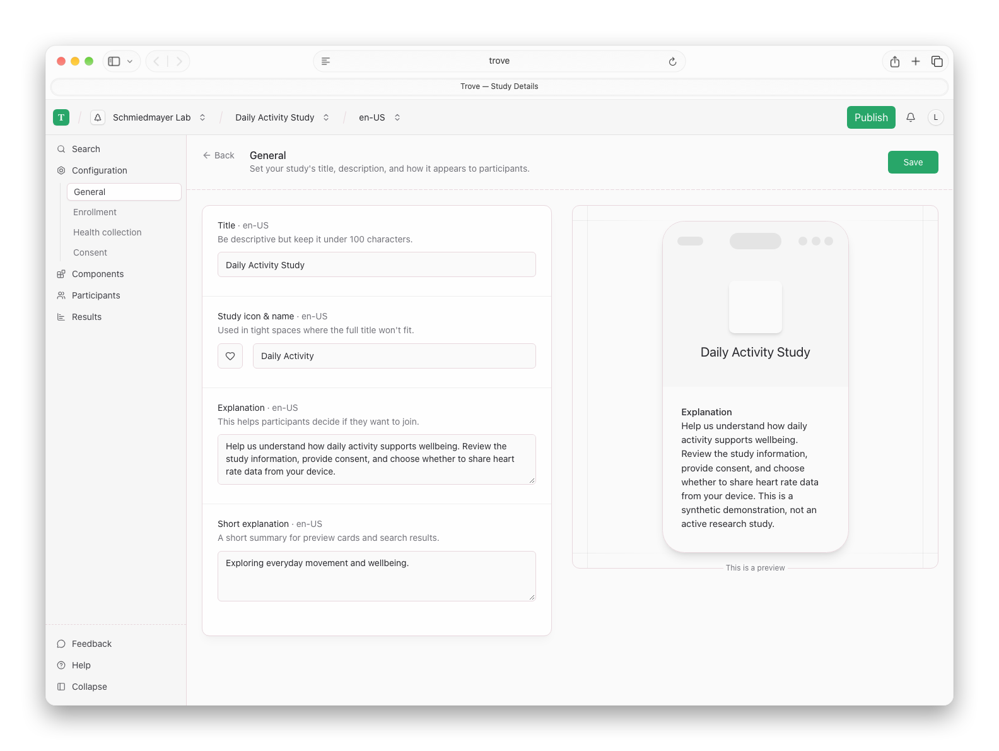</picture>

Eligibility and enrollment settings

<picture><source media="(prefers-color-scheme: dark)" srcset="images/web/enrollment~dark.png">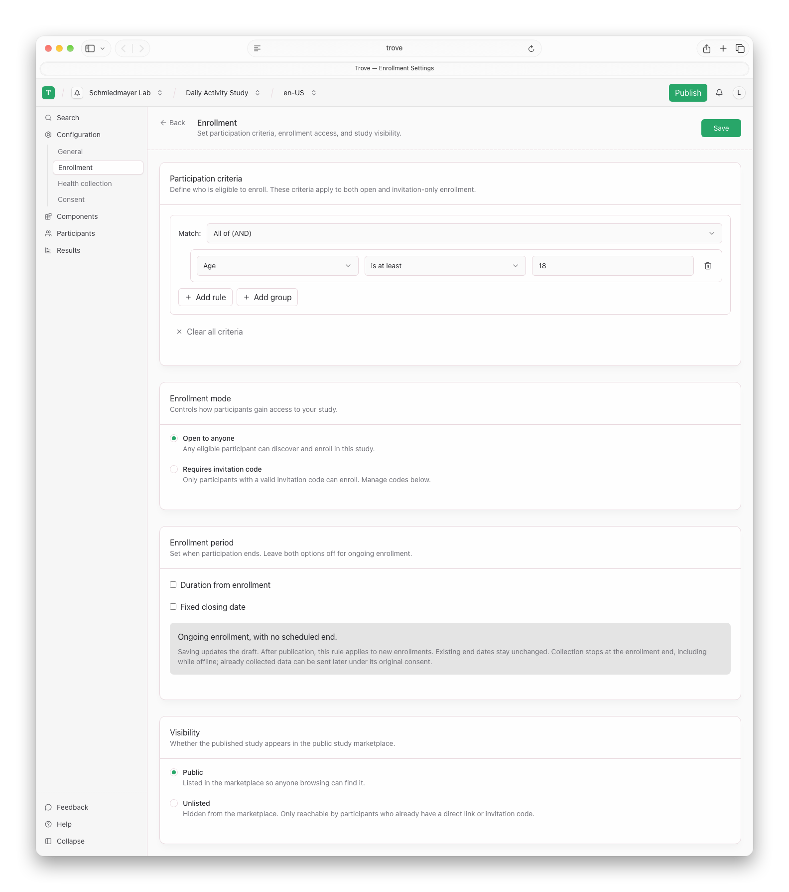</picture>

Health collection lists every measurement the deployment can collect, from
HealthKit, SensorKit and approved provider registrations. For each selected
measurement, researchers set when measurements start: from participant acceptance,
a calendar lookback in a declared time zone, a specific date or all available
history. Workouts can include location routes, and some outputs require explicitly
selected companion outputs. Participants accept this scope with the published
revision; each window is resolved once at acceptance.

<picture><source media="(prefers-color-scheme: dark)" srcset="images/web/collection~dark.png">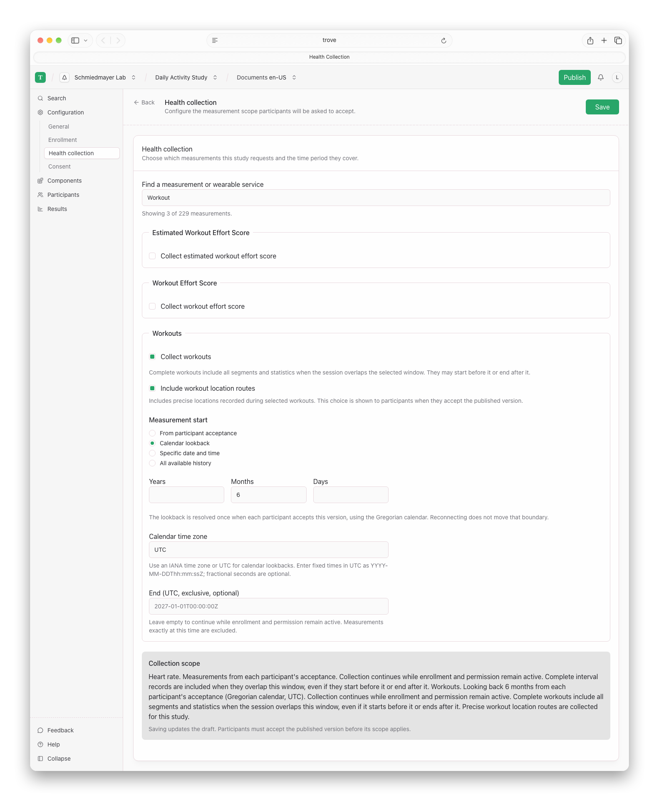</picture>

Consent documents combine Markdown with native agreement and signature controls.
Researchers can switch between a readable preview, a visual editor and Markdown.
Agreement, selection and signature fields have editable IDs and options. The
editor checks duplicate IDs and keeps response references consistent when options
are renamed. Constructs outside the visual editor's supported set remain editable
in Markdown. The preview shows the document without collecting participant responses.

<picture><source media="(prefers-color-scheme: dark)" srcset="images/web/consent~dark.png">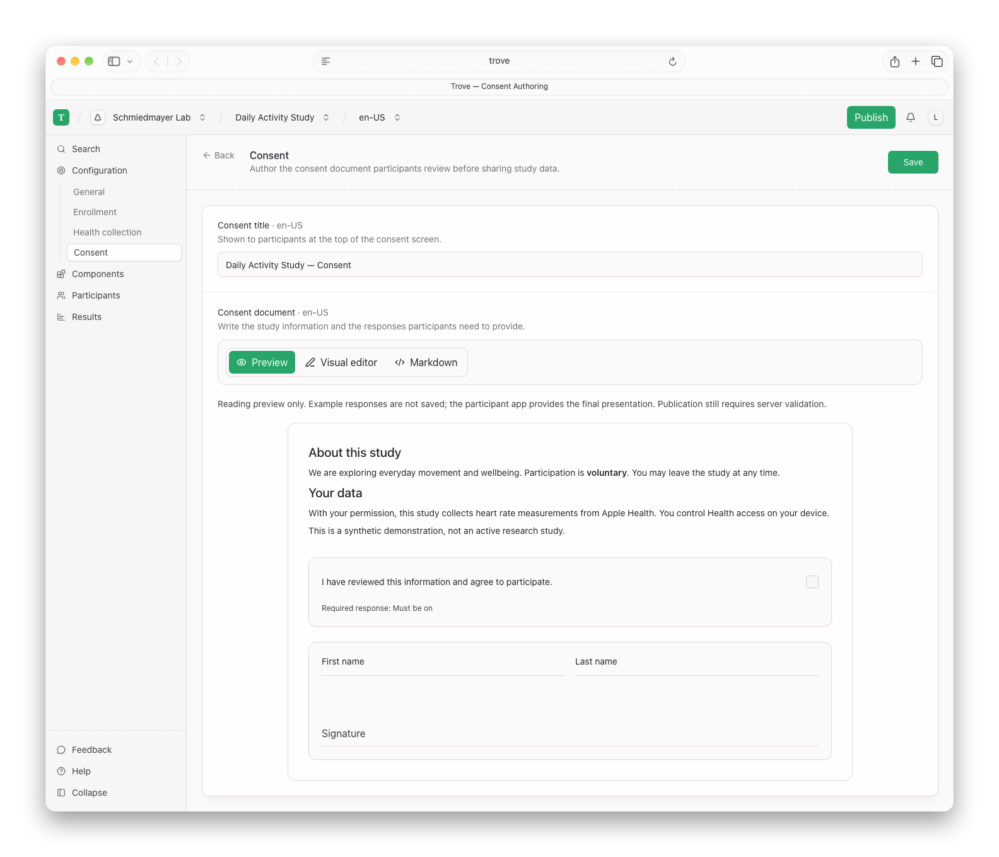</picture>

<picture><source media="(prefers-color-scheme: dark)" srcset="images/web/consent-editor~dark.png">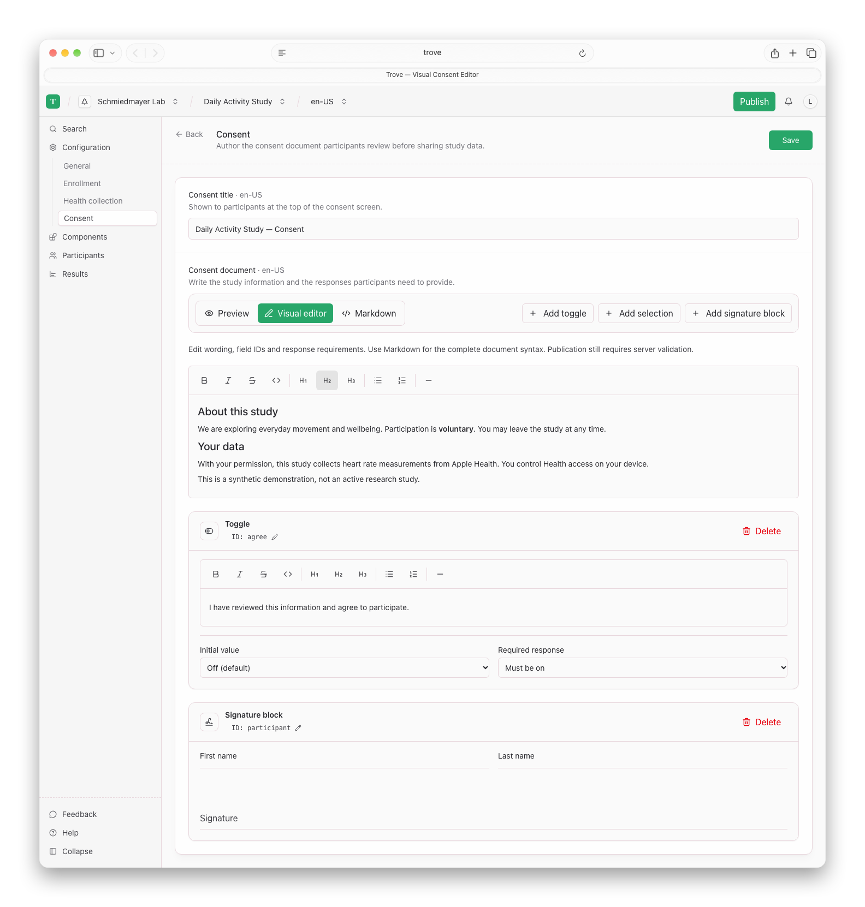</picture>

Study components include information, FHIR Questionnaires and health-data
configuration. Scheduling defines when a component should become available;
this editor does not establish server-driven task execution or reminders.

Components, information and scheduling

<picture><source media="(prefers-color-scheme: dark)" srcset="images/web/component-types~dark.png">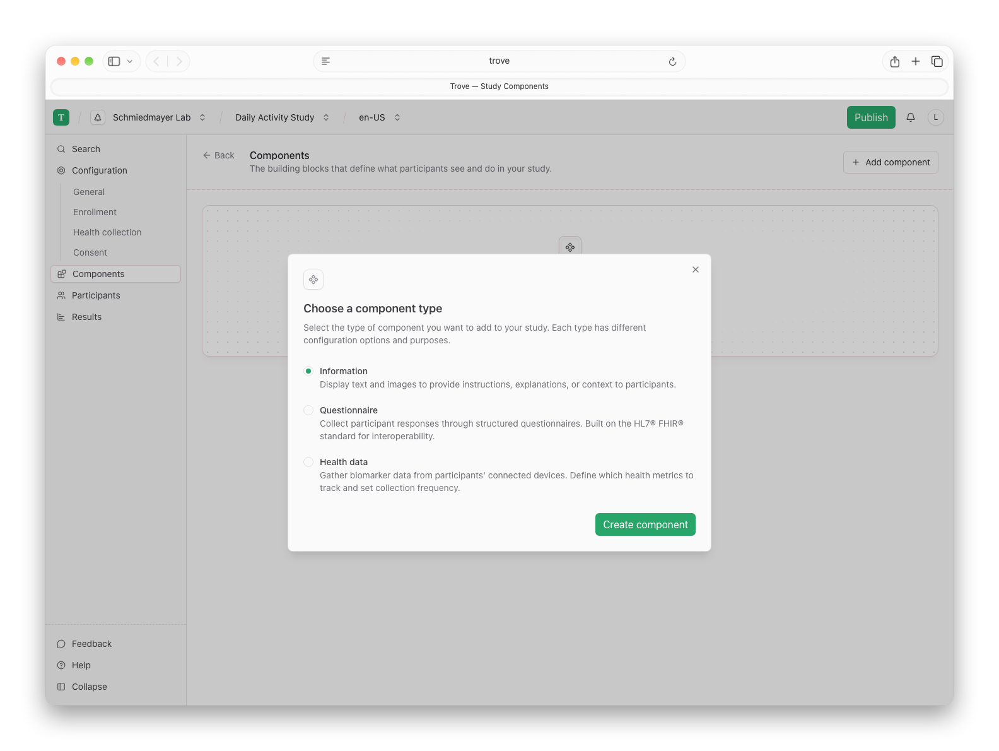</picture>
<picture><source media="(prefers-color-scheme: dark)" srcset="images/web/information~dark.png">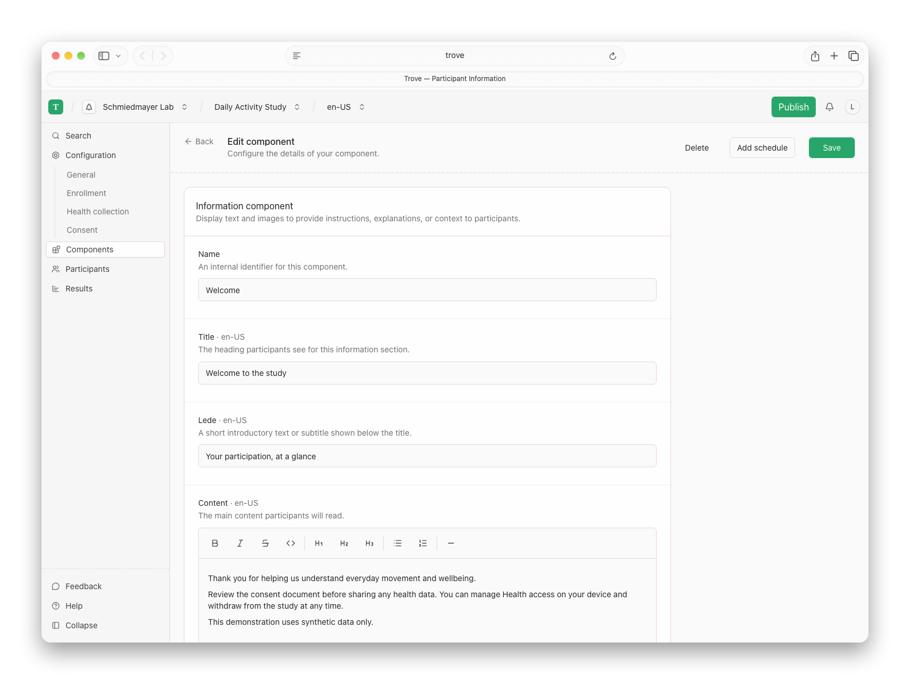</picture>
<picture><source media="(prefers-color-scheme: dark)" srcset="images/web/schedule~dark.png">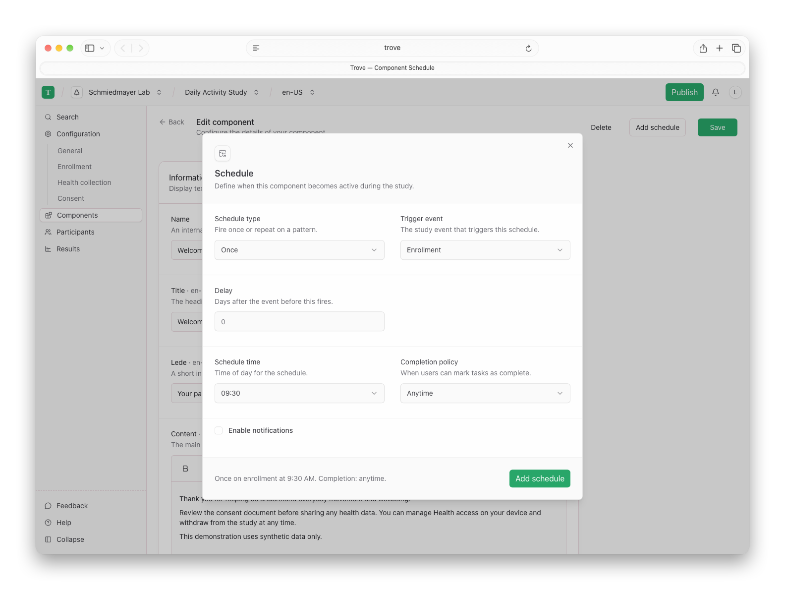</picture>

Publication is an explicit review step. Validation produces an exact, expiring
candidate; the researcher publishes that candidate rather than an unseen newer
draft. The illustrated study does not contain a Questionnaire.

<picture><source media="(prefers-color-scheme: dark)" srcset="images/web/publication~dark.png">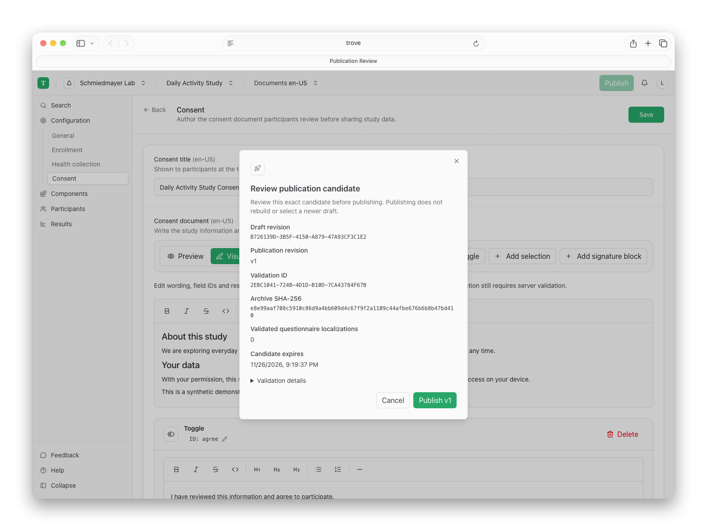</picture>

Researchers with the study-data capability open **Results** to page through the
study's authorized measurements as FHIR, optionally including superseded versions,
and to download recordings. Each page and download checks current authority and
records a disclosure audit first. The CLI's `trove study data` command uses the
same API.

## Participant App

Participants sign in, discover published studies, review eligibility and study
information, and enroll. Consent is reviewed separately before health-data
collection is authorized. All mobile images below are captured from the current
app through RocketSim, with device bezels and synthetic account data.

<table>
  <tr><th>Study Discovery</th><th>Study Information</th><th>Consent Review</th></tr>
  <tr>
    <td><picture><source media="(prefers-color-scheme: dark)" srcset="images/mobile/studies~dark.png">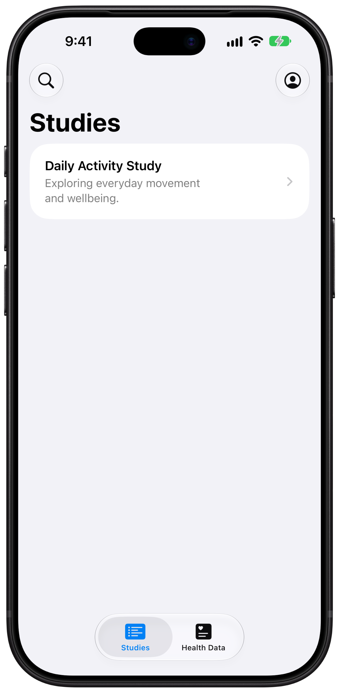</picture></td>
    <td><picture><source media="(prefers-color-scheme: dark)" srcset="images/mobile/study~dark.png">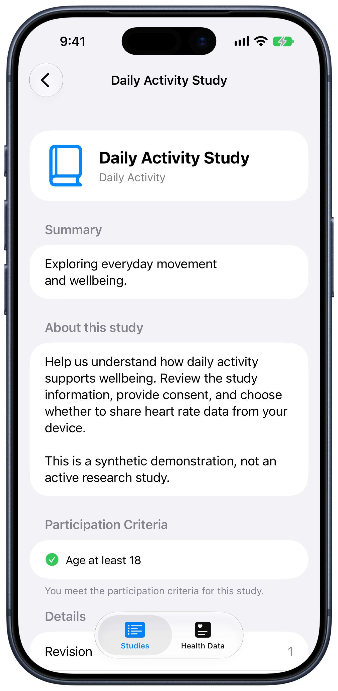</picture></td>
    <td><picture><source media="(prefers-color-scheme: dark)" srcset="images/mobile/consent~dark.png">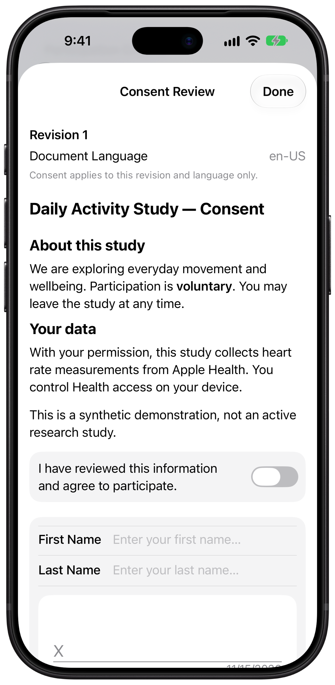</picture></td>
  </tr>
</table>

Health-data setup

<picture><source media="(prefers-color-scheme: dark)" srcset="images/mobile/health-data~dark.png">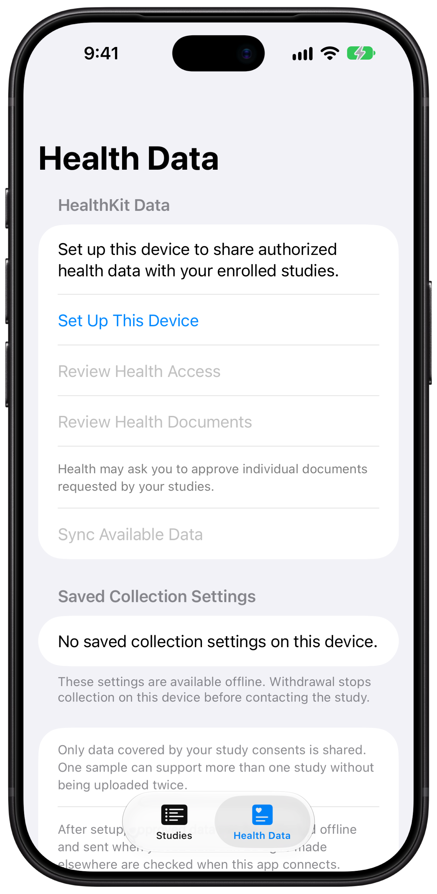</picture>

Health Data separates device setup, Health access review, review of requested
health documents and delivery. When a deployment configures provider
registrations, it also lists wearable services with their connection status.
Saved collection settings stay available offline, and withdrawing there stops
collection on the device before the study is contacted. This capture shows the
setup screen, not authorized collection or successful sample delivery.

## Current Scope

The screenshots cover study authoring, health-collection settings, publication,
discovery, enrollment and consent review. The [Swift CLI guide](https://github.com/SchmiedmayerLab/Trove/blob/main/TroveAPI/CLI.md)
documents the command-line authoring and study-data operations.

Trove is in beta and is being actively tested and used at Stanford.
The illustrated study and accounts are synthetic.
