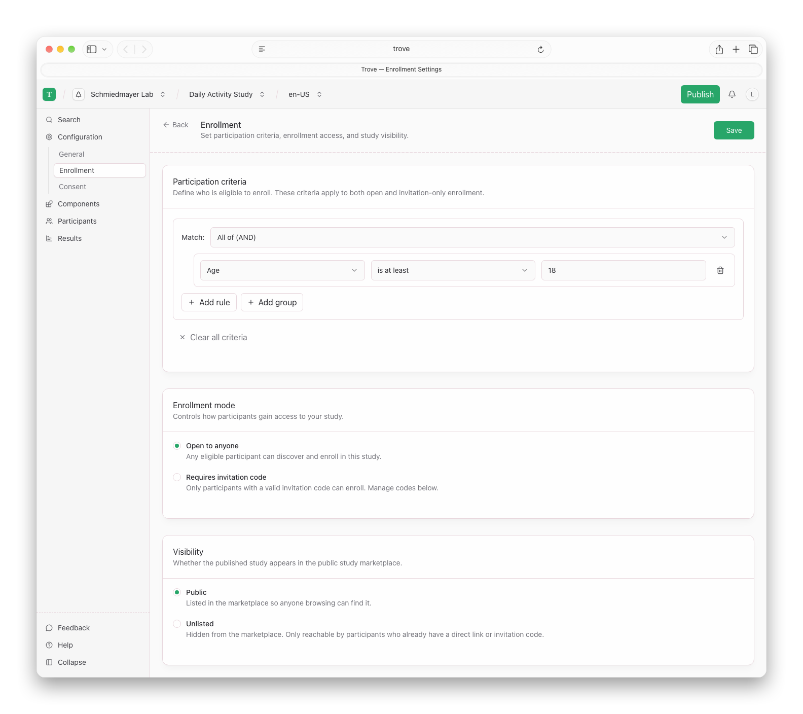
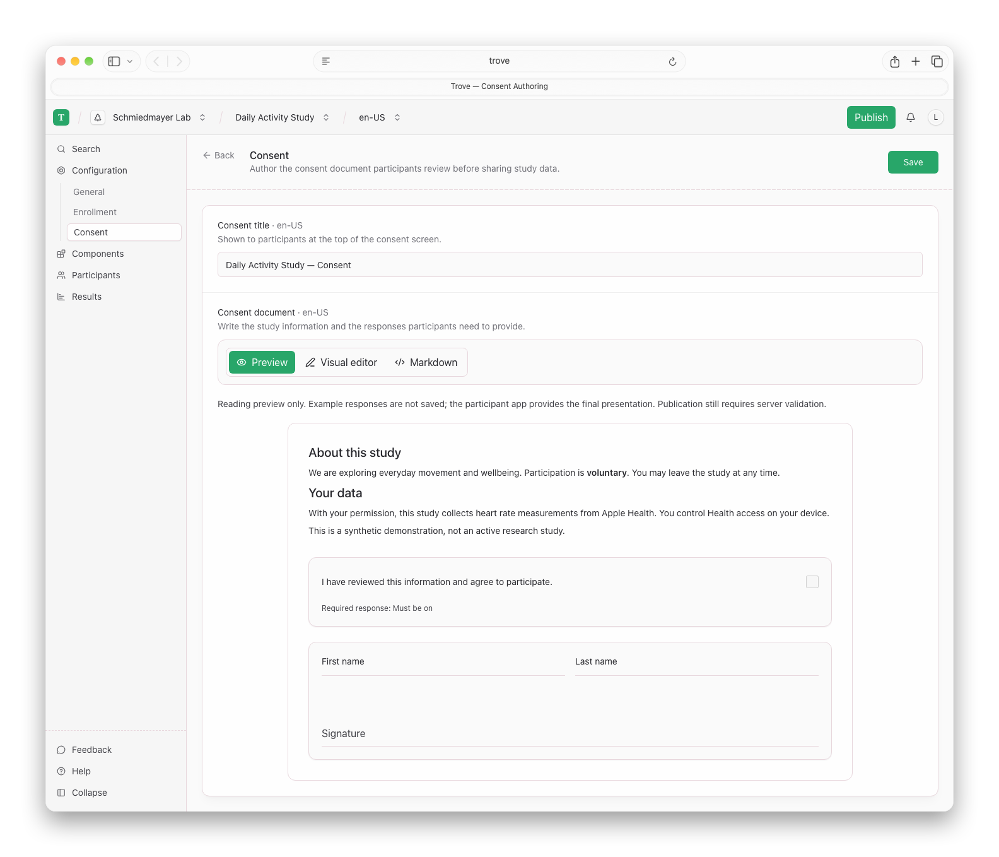
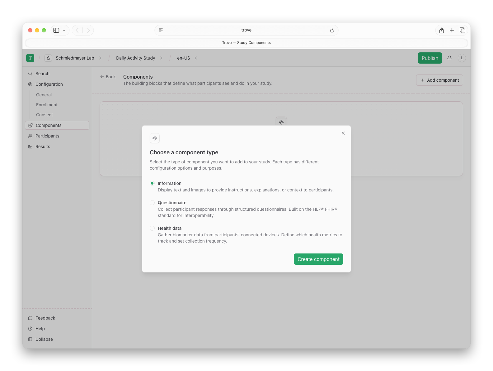
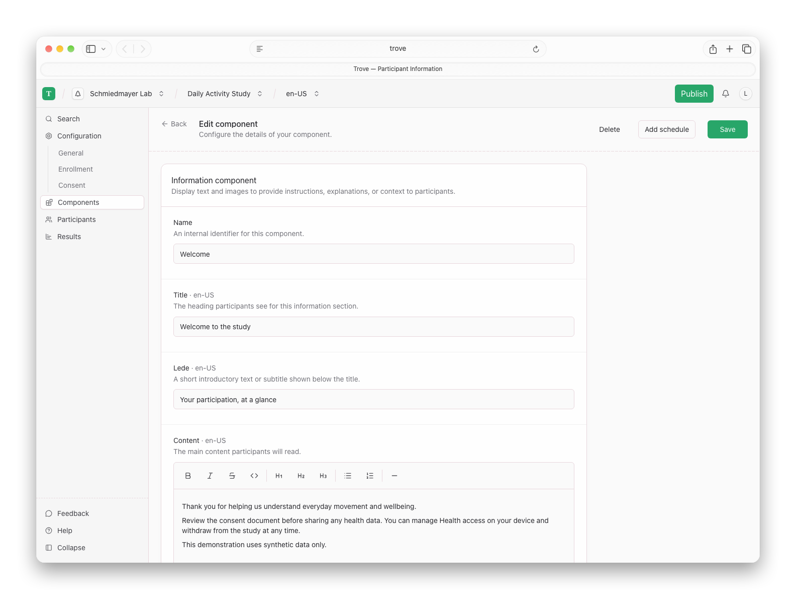
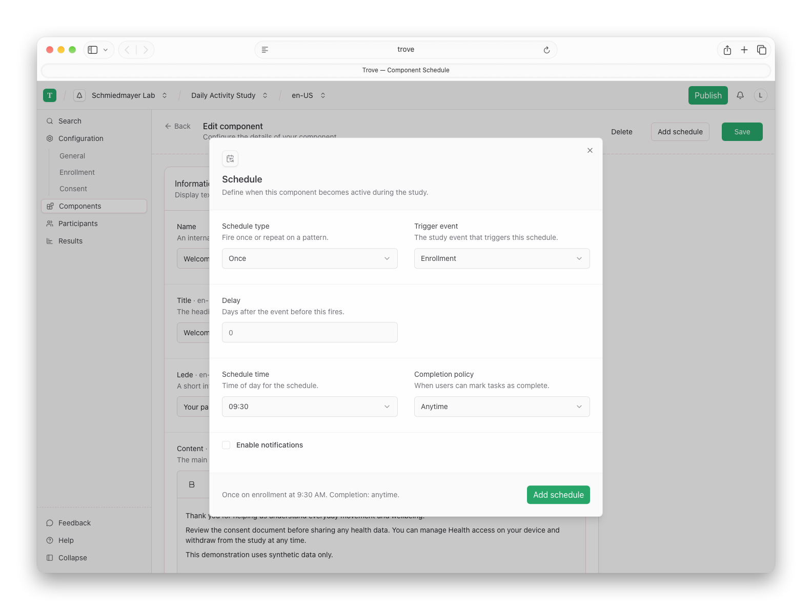
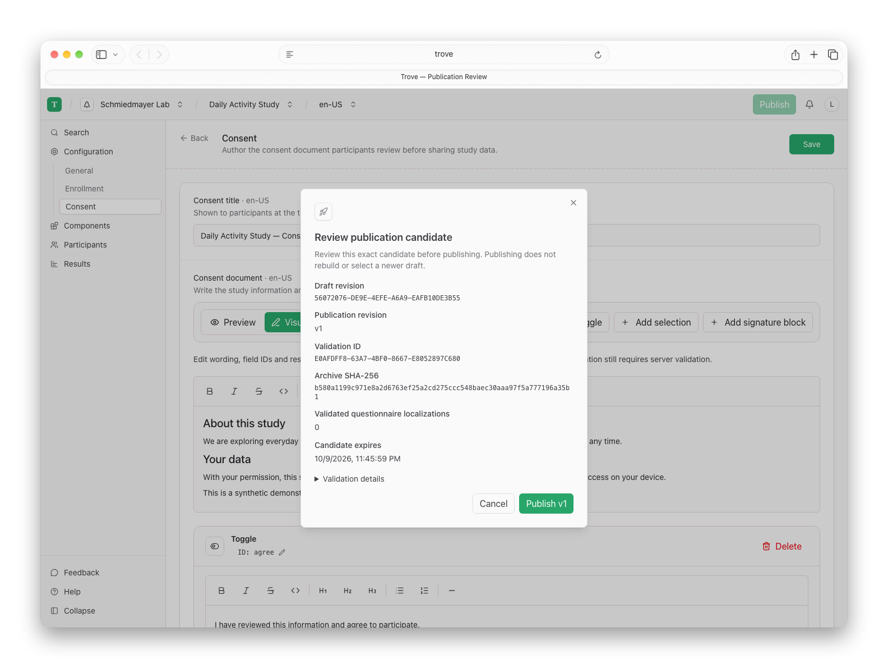
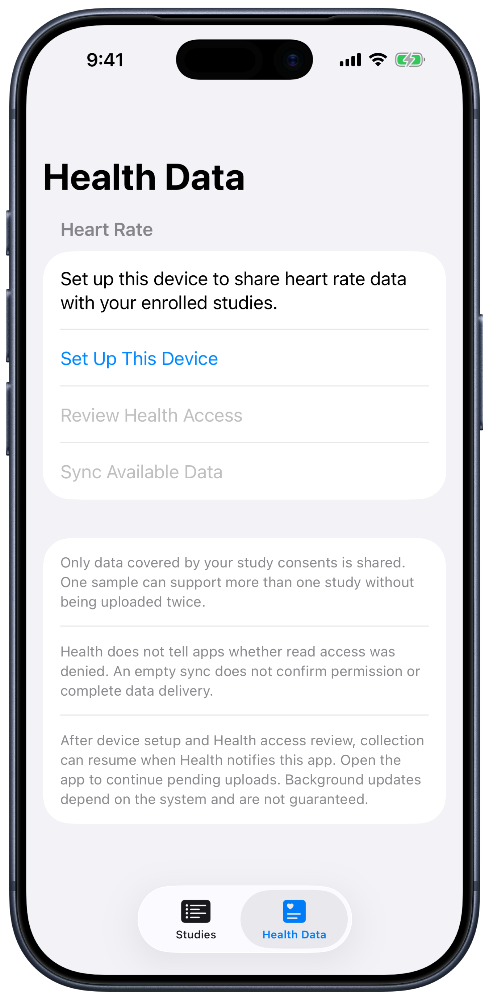

<!--
SPDX-FileCopyrightText: 2026 Schmiedmayer Lab and the project authors (see CONTRIBUTORS.md)
SPDX-License-Identifier: MIT
-->

# Platform Tour

Trove connects researcher-authored study definitions with participant identity,
enrollment, reviewed consent and health-data collection. These screenshots show
a development build with a synthetic **Daily Activity Study**, not an active study
or evidence of production readiness. [Capture details and reproduction](images/README.md).

## Study Authoring

Researchers configure a study in order: general information, enrollment and
participation criteria, then consent. Study components have their own top-level menu.

<picture><source media="(prefers-color-scheme: dark)" srcset="images/web/study-details~dark.png"></picture>

Eligibility and enrollment settings

<picture><source media="(prefers-color-scheme: dark)" srcset="images/web/enrollment~dark.png"></picture>

Consent documents combine Markdown with native agreement and signature controls.
Researchers can switch between a readable preview, a visual editor and Markdown.
The visual editor exposes agreement, selection and signature fields, including
editable field and option IDs. Renaming an option updates its default and required
response references; duplicate IDs are rejected. Deletion requires confirmation
and affects the current draft only. Unsupported constructs remain available in Markdown.
The participant reviews the document attached to their study revision; the web
preview does not collect responses or replace publication validation.

<picture><source media="(prefers-color-scheme: dark)" srcset="images/web/consent~dark.png"></picture>

<picture><source media="(prefers-color-scheme: dark)" srcset="images/web/consent-editor~dark.png"></picture>

Study components include information, FHIR Questionnaires and health-data
configuration. Scheduling defines when a component should become available;
this editor does not establish server-driven task execution or reminders.

Components, information and scheduling

<picture><source media="(prefers-color-scheme: dark)" srcset="images/web/component-types~dark.png"></picture>
<picture><source media="(prefers-color-scheme: dark)" srcset="images/web/information~dark.png"></picture>
<picture><source media="(prefers-color-scheme: dark)" srcset="images/web/schedule~dark.png"></picture>

Publication is an explicit review step. Validation produces an exact, expiring
candidate; the researcher publishes that candidate rather than an unseen newer
draft. This example contains **no Questionnaires** and makes no claim of
Questionnaire validation coverage.

<picture><source media="(prefers-color-scheme: dark)" srcset="images/web/publication~dark.png"></picture>

## Participant App

Participants sign in, discover published studies, review eligibility and study
information, and enroll. Consent is reviewed separately before health-data
collection is authorized. All mobile images below are captured from the current
app through RocketSim, with device bezels and synthetic account data.

<table>
  <tr><th>Study Discovery</th><th>Study Information</th><th>Consent Review</th></tr>
  <tr>
    <td><picture><source media="(prefers-color-scheme: dark)" srcset="images/mobile/studies~dark.png"></picture></td>
    <td><picture><source media="(prefers-color-scheme: dark)" srcset="images/mobile/study~dark.png"></picture></td>
    <td><picture><source media="(prefers-color-scheme: dark)" srcset="images/mobile/consent~dark.png"></picture></td>
  </tr>
</table>

Health-data setup

<picture><source media="(prefers-color-scheme: dark)" srcset="images/mobile/health-data~dark.png"></picture>

The app separates device setup, Health access and delivery. This capture shows
the setup screen, not authorized collection or successful sample delivery.

## Scope of This Demonstration

This walkthrough covers study authoring, publication, authenticated discovery,
eligibility presentation, enrollment and consent review. It does not demonstrate
randomization, intervention allocation, automated follow-up, outcome analysis,
cross-platform task completion, or an operational clinical deployment. The
[roadmap](Roadmap-and-Engineering-Principles.md) tracks those capabilities.

The questionnaire branching graph, assisted authoring and researcher CLI should
be documented through their working interfaces as they mature—not illustrated
as features already present in these screenshots.
