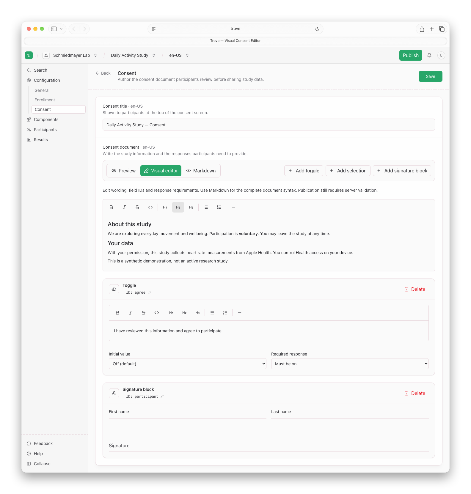
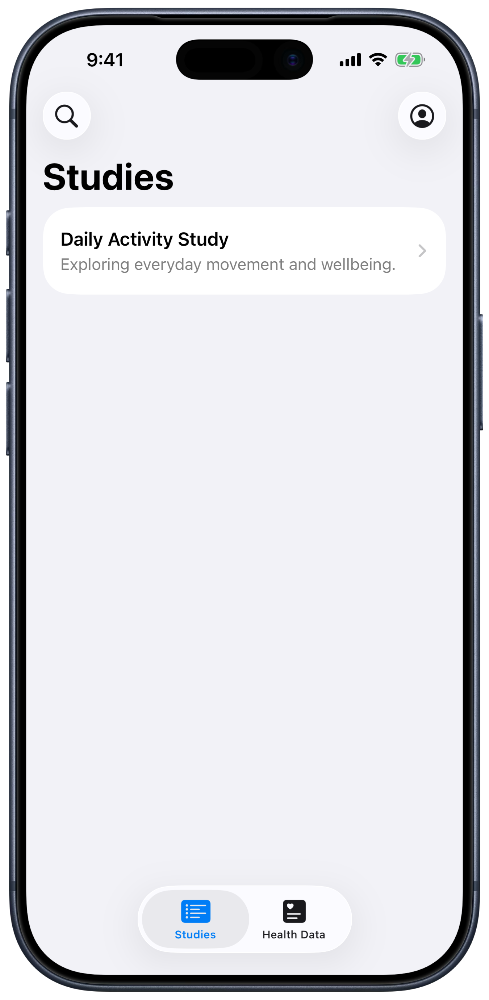
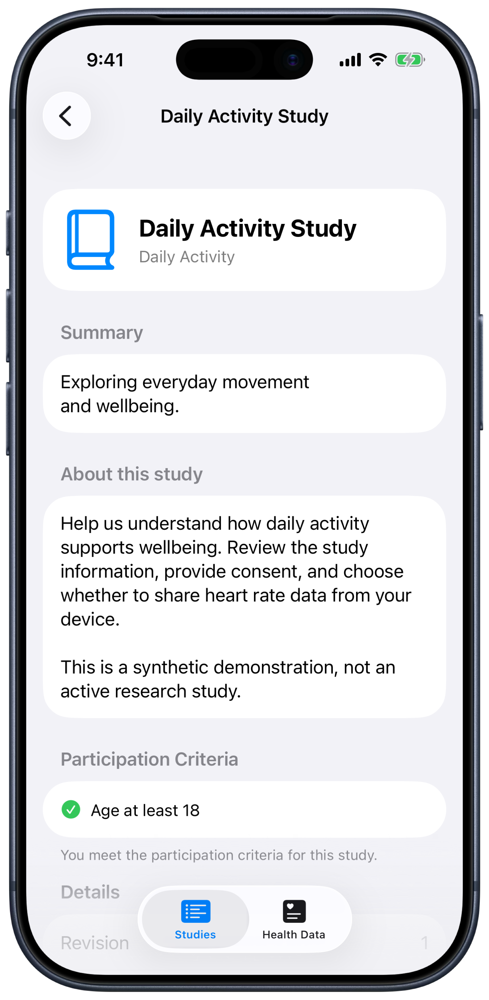
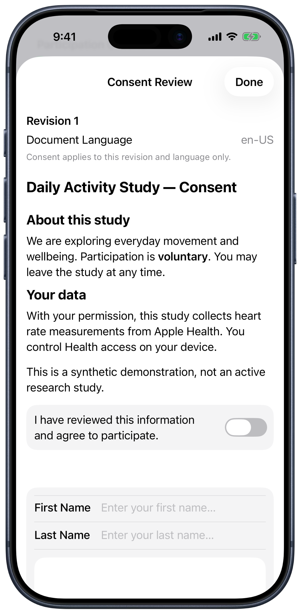

<!--
SPDX-FileCopyrightText: 2026 Schmiedmayer Lab and the project authors (see CONTRIBUTORS.md)
SPDX-License-Identifier: MIT
-->

Open-source digital health research

# From study design to participant experience.

Trove brings study authoring, enrollment, consent, and health-data collection
together. Build on a shared foundation, with room for the experience your study needs.

[Explore the Platform](Platform-Tour.md){ .md-button .md-button--primary }
[Run Trove Locally](https://github.com/SchmiedmayerLab/Trove#running-it-locally){ .md-button }

Built with Swift and Grove · FHIR-aligned exchange · MIT licensed

<figure class="trove-showcase">
  <picture><source media="(prefers-color-scheme: dark)" srcset="images/web/study-details~dark.png"></picture>
  <figcaption>Define a study and see how it will appear to participants. All screenshots use synthetic data.</figcaption>
</figure>

<section class="trove-section" markdown>

For research teams

## One study definition. A connected workflow.

Configure eligibility and enrollment, write consent documents, and organize study
components. Review a publication candidate before making that exact revision
available to participants. Later draft edits stay separate from published content.

<ol class="trove-workflow">
  <li><strong>Define</strong>Study information, eligibility, and components.</li>
  <li><strong>Review</strong>Consent wording and the publication candidate.</li>
  <li><strong>Enroll</strong>Authenticated discovery and participation.</li>
  <li><strong>Collect</strong>Health-data delivery with study-specific authorization.</li>
</ol>

[See the Authoring Workflow →](Platform-Tour.md#study-authoring)

</section>

<section class="trove-split trove-section" markdown>

Consent, made readable

## Clear documents. Explicit agreement.

Write consent in Markdown or use the visual editor for agreement, selection, and
signature fields. Participants review the document attached to their study revision
in the native app before authorizing collection.

[Explore Consent and Enrollment →](Study-Model-and-Research-Workflows.md)

<picture><source media="(prefers-color-scheme: dark)" srcset="images/web/consent-editor~dark.png"></picture>

</section>

<section class="trove-section" markdown>

For participants

## A study they can understand. An app they can use.

Discover published studies, review the details, and provide consent in the iOS app.
The platform's direction is a shared backend that also supports study-specific
applications without prescribing their interface.

  <figure><picture><source media="(prefers-color-scheme: dark)" srcset="images/mobile/studies~dark.png"></picture><figcaption>Discover a study</figcaption></figure>
  <figure><picture><source media="(prefers-color-scheme: dark)" srcset="images/mobile/study~dark.png"></picture><figcaption>Review the details</figcaption></figure>
  <figure><picture><source media="(prefers-color-scheme: dark)" srcset="images/mobile/consent~dark.png"></picture><figcaption>Provide consent</figcaption></figure>

</section>

<section class="trove-section trove-foundation" markdown>

A foundation you can build on

## Shared data does not mean shared permission.

Trove stores an event once and authorizes access independently for each study.
Swift powers the server, CLI, and iOS app; the web dashboard uses the same typed API.
[Grove](https://github.com/SchmiedmayerLab/Grove) supplies reusable application
components, and the [Grove FHIR implementation guides](https://schmiedmayerlab.github.io/grove-fhir/)
define the exchange contracts.

[Read the Architecture](Data-and-Platform-Architecture.md){ .md-button }
[Understand the Vision](Vision.md){ .md-button }

</section>

<section class="trove-section" markdown>

## Explore what is here. Help shape what comes next.

Trove is under active development. The tour shows implemented development flows,
not a production-ready clinical service. Randomization, automated follow-up,
conversational studies, and assisted authoring remain roadmap work; they are not
capabilities demonstrated by these screenshots.

[Follow the Roadmap](Roadmap-and-Engineering-Principles.md){ .md-button .md-button--primary }
[Contribute on GitHub](https://github.com/SchmiedmayerLab/Trove){ .md-button }

</section>

